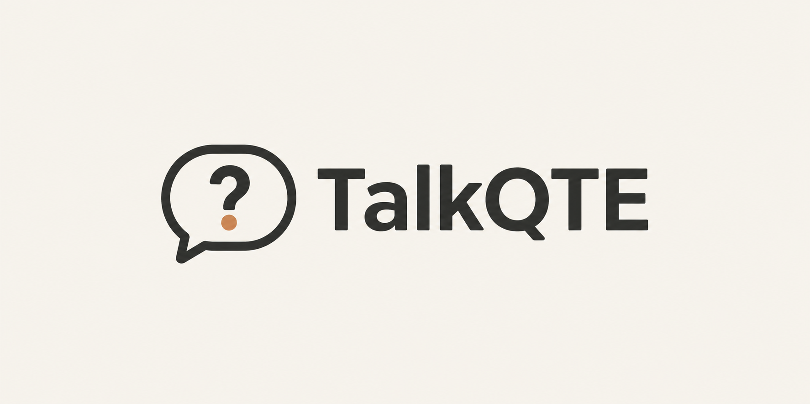

# TalkQTE

**AI cues that help you stay grounded and respond in the moment.**

⭐ **Star the repo to follow development.** It is early, built in public, and not yet something to install for real meetings.

TalkQTE is a small meeting companion being built to follow the conversation and surface useful context while it still matters. That might be a reminder of an earlier constraint, a point worth clarifying, or a prompt to help you respond. The aim is to help you keep up without pulling you away from listening.

One cue appears in a quiet floating window. It says what it is and quotes the line or note it came from. You can hold it, dismiss it, or let it pass. There is no Save step or queue of questions to manage. Your existing note-taker can remain the record of what was actually said.

## The experience we are working toward

This fictional example illustrates the intended experience, not functionality the current prototype provides:

| In the conversation         | TalkQTE could surface                        |
| --------------------------- | -------------------------------------------- |
| “Can we commit to Friday?”  | “Earlier, legal said review takes two days.” |
| You need to respond         | “Will the draft be ready Wednesday?”         |
| Someone resolves the timing | Clear the cue and stay quiet.                |

AI is intended to select relevant context, decide whether a cue would help, and recognize when it is no longer useful. Clarification questions are one cue type. Generating more prompts or getting someone to speak more is not the goal.

## Where it stands today

**Early development.** The app runs from source on macOS. Ordinary builds have no live transcription or model connection. A `local-whisper` developer build transcribes your microphone locally and applies phrase rules; opt-in development paths add selected-application audio and subscription-model cue decisions. The first integrated fictional meeting → real capture/transcription → model cue or silence → visible companion take remains unverified. These paths do not establish reliable meeting understanding or simultaneous microphone and remote-call capture. There is no supported public release; the [macOS release path](docs/release-path.md) lists what is configured and what remains.

| Working prototype                                                                                                          | Still to build and validate                                                             |
| -------------------------------------------------------------------------------------------------------------------------- | --------------------------------------------------------------------------------------- |
| Phrase-based live cues; opt-in development model evaluator hooks                                                           | Integrated live-model timing, grounding and visible-companion acceptance                |
| Floating companion, source disclosure, pause, and dismissal                                                                | Useful timing, and semantic suppression of answered questions and stale cues            |
| Phrase-based withdrawal for answers, corrections, and topic openings; the same question is not repeated within two minutes | Recognizing paraphrased answers, duplicates, and topic changes said in other words      |
| Opt-in microphone check; local transcription and selected-app spike                                                        | Simultaneous microphone/remote audio and real-meeting accuracy                          |
| Selected file-note imports, title-match reminders, and a development Granola connection                                    | Account refresh/recovery checks, and evidence that reminders help rather than interrupt |
| In-memory notes and reviewed Markdown export                                                                               | Reliable meeting use, processing choices, and install/update support                    |

The microphone indicator measures signal activity only. It does not transcribe or record, and it raises no cues. A live session is separate: see [Live session](#live-session-developer-build). Granola sign-in, listing, and requested focus suggestions have worked in account checks; the owner also confirmed native note import and removal on 11 November. Refresh, failure recovery and account data-flow checks remain. Imported-note reminders use title-word matches, not a judgment of relevance. See [current privacy behavior](PRIVACY.md) and the [native validation record](docs/native-validation.md) for the limits of existing checks.

**Microphone input:** after an explicit start, the notebook and Settings show the opened input name when available. Expand **Change microphone** for the stop → choose macOS input → restart steps. This is a device label and guidance, not an in-app device picker or automatic switching. [Fictional checks and remaining native acceptance](docs/microphone-input.md).

**Notebook:** the notebook is about your own session. Before one it says **No session yet** and that nothing is being captured. During a live session it shows where the audio comes from, the elapsed time, **Pause cues**, the transcript and the one cue. After Stop it says **Live session ended** and that nothing was saved; the transcript stays until you start another session or quit, and your notes until you quit. Cues appear only during a live session, which an ordinary build cannot run, so an ordinary build shows no cue and says so. There is no in-app demo; fictional demonstrations come from the lab's simulations and recordings ([batches and simulations](docs/cue-simulation.md)). The voiced demo that the app carried until 14 November 2026 is described in [its record](docs/voiced-demo.md).

**Quieter notebook:** one sidebar holds Notebook, the optional setup checklist and Settings, with no meeting list or search because nothing is kept between launches; narrow windows use a compact header. The editor and cue area come before optional meeting focus. Expand **This meeting** to edit Focus, or **Set up a live session** in the sidebar for the first-run checklist. Import, export, microphone status and Stop remain reachable. See the [layout and interaction checks](docs/notebook-simplification.md).

**Adjustable panels:** drag the notebook divider or the divider between Notes/Transcript and the question. Focus a divider for arrow-key resizing, or use **Panel sizes** in the toolbar for sliders and reset. Narrow windows stack the panels; sizes last for the app session. See the [interaction checks and native limitations](docs/panel-sizing.md).

## Where we are heading

The direction is to grow from a proof of concept into a dependable AI companion that works with existing meeting tools and becomes available across desktop and mobile platforms.

| Stage                             | What it delivers                                                                                                                                    |
| --------------------------------- | --------------------------------------------------------------------------------------------------------------------------------------------------- |
| **1. Proof of concept — current** | A desktop prototype and fictional lab simulations to explore cue presentation, timing, and controls.                                                |
| **2. Live AI companion**          | Meeting audio, transcription, and relevant AI cues working together reliably on macOS.                                                              |
| **3. Connected workflows**        | Supported connections to meeting and note-taking tools, with selected context and clear permissions.                                                |
| **4. Broader availability**       | Easy installation and updates, Windows as the next desktop target, and a mobile companion as its live-context and presentation paths are validated. |

These are development milestones, not announced release dates or current capabilities. Integrations, reliability, and platform feasibility are planned alongside the core experience; each supported release must work end to end. See the [development milestones](docs/initial-rollout.md) and [detailed roadmap](ROADMAP.md).

**Platform direction:** macOS first, Windows next. Ubuntu/Linux is an exploratory track. iPhone and Android are future companion goals, including receiving cues while using Google Meet on a phone; same-phone call access still needs to be proven. See the [platform plan](docs/platforms.md) and [mobile feasibility plan](docs/mobile.md).

[Follow development on GitHub](https://github.com/connorburgess/talkqte).

## Run the current prototype

The stack is Rust, Tauri 2, React, and TypeScript. Local Whisper transcription is available only in a `local-whisper` developer build, with model setup in Settings or a developer-supplied model path. The AI cue runtime is still being evaluated, and a lab model is not automatically the production choice.

On macOS, install Node.js 22, Rust 1.97.1, and Xcode Command Line Tools. The app bundle requires macOS 14.0 or later; only macOS 26.4 has been tested. See [Tauri's prerequisites](https://v2.tauri.app/start/prerequisites/).

```sh
npm ci
npm run desktop
```

`npm run dev` serves the same notebook in a browser at `http://127.0.0.1:1420`, with no microphone and no live session, so it shows no cue. What the notebook, companion, focus list, prior notes, and export do today, with their limits, is in [Run the prototype](docs/run-the-prototype.md).

For Windows development, `npm run tauri -- build --debug --ci` selects NSIS and keeps installer tools in the project's build directory. See the [Windows prerequisites and packaging check](docs/platforms.md#current-build-and-installer-packaging-11-november-2026). The unsigned Arm debug installer has been built but not installed or launched; it is not a supported release.

Open **Prior context** to import selected file notes or connect Granola. Sign-in, listing and requested Focus suggestions have worked in account checks; basic native note import/removal was confirmed on 11 November. Imported copies stay in memory until removed or quit and are excluded from export. Reimporting a newer revision updates a kept note and clears a cue quoting its old revision. Imports preserve selection on failure for an explicit retry; Disconnect retires pending connection results but keeps imported copies. Ongoing refresh is not offered on the real connection. Real-account refresh, recovery and data-flow acceptance remain open. See [import evidence and recovery](docs/granola-import-validation.md), [list recovery](docs/context-list-recovery.md) and [refresh limits](docs/selected-note-refresh-plan.md).

## Live session (developer build)

A live session transcribes your microphone on this Mac and runs the phrase-based questions on what it hears. It is off in ordinary builds. To try it, build with the `local-whisper` feature (needs CMake):

```sh
npm run tauri -- dev --features local-whisper
```

Then choose **Download speech model** in Settings; **Set up live session** in the notebook opens it. It fetches the 78 MB `tiny.en` model over HTTPS from the whisper.cpp repository on Hugging Face, at a pinned revision, checks it against a pinned SHA-256, and keeps it in the app's data folder; **Remove model** deletes it. Hugging Face and its download network see your IP address and a file request from TalkQTE; no account, audio, transcript, or notes are sent. A dropped connection resumes with further requests. A developer can instead point `TALKQTE_WHISPER_MODEL` at their own model file, which is not checksum-checked.

Choose **Start live session** in the notebook and grant microphone permission if asked. **Stop live session**, in the notebook or companion, releases the microphone, finishes transcribing the last few seconds, and ends the session; **Stop microphone** does the same. If microphone access is refused or the device fails, the session ends. Speech is transcribed in chunks of up to 3 seconds, ending early at a pause, so lines appear about 3 seconds after they are spoken in a synthetic replay; the delay on real hardware has not been measured. Audio is not recorded. The transcript stays in memory until you start another session or quit and is never exported. Export is unavailable while a live session runs; after Stop it exports your notes only. This microphone-only path does not capture other apps' audio. The separate macOS `native-audio-spike` development path can capture one selected application's audio; see the [fictional real-app lab](docs/real-app-lab.md) for its scope and historical checks. Settings shows whether this build and model support a live session. After installation or removal, it shows **Checking…** until the current readiness check finishes; an older reply cannot change that result or the notebook's Start option.

**Pause cues**, in the notebook or companion, clears the current suggestion and keeps cues quiet while the microphone, transcript, and session clock continue. **Resume cues** waits for newly spoken lines; delayed speech from the pause does not become a new cue. The companion shows **Cues off / Mic still on** while paused. Use **Stop live session** to stop listening. These controls are [checked headlessly](docs/live-cue-pause.md); native microphone and cross-app acceptance remain separate.

This has been checked with synthetic audio and a scripted recognizer in tests. The download is tested against a simulated server, plus one ranged request to the real source. A first microphone session is recorded in the [native validation notes](docs/native-validation.md#live-session-check); measured latency, Stop/device edge cases, real-meeting accuracy and clean-install first-use acceptance remain open in the [model delivery plan](docs/model-delivery.md).

**Cancel start** appears beside microphone status while the local speech model prepares. Cancellation prevents capture even if preparation finishes later; wait for it to finish before starting again. **Stop live session** stays beside microphone status in both Notebook and Settings, independently of pending notebook actions. Microphone status confirms release; the session can keep finishing queued transcription afterward. This [notebook flow is checked headlessly](docs/notebook-capture-controls.md) on fictional IPC, over the [native cancellation race tests](docs/live-start-cancellation.md). Real-device Stop and permission checks remain pending.

**Cue processing** is available as a status and permission surface in the live notebook and Settings. The normal app has no model connection: it says **No model connection** and "No model cues: this build has no model connection."

A development build with the `claude-cli` feature connects cue decisions to Claude through the Claude Code CLI on your Mac and your own Claude subscription. It is for the owner's own development use. It **sends conversation lines off this Mac to Anthropic**, after you review and turn on Cue processing for the session. In a debug build with both `claude-cli` and `native-audio-spike`, an explicit launch setting can approve conversation-only processing without clicks, with a session call cap (default 100); see [development launch consent](docs/real-app-lab.md#model-connection-without-clicks). The notebook says while lines are being sent, and the companion shows a cloud while the connection is on. See [what is sent, when, and what happens on failure](docs/cue-model.md) and [PRIVACY.md](PRIVACY.md). The launch setting has only offline acceptance evidence; native use and model latency remain unverified for this change. Fictional headless checks cover source review, approval, Pause/Disable, failures and independent Stop through the real notebook; this does not enable a model or establish native/device acceptance. See the [permission flow and UI/UX checkpoint](docs/notebook-processing-controls.md).

A separate [development lab evaluator client](docs/development-lab-evaluator.md) has development-only native selection, consent, publication, clock and Stop hooks for an explicitly selected Claude/Codex subscription broker with shared dispatch accounting and strict cancellation. An explicitly opted-in QuickTime-only [owned-process Stop handshake](docs/development-lab-evaluator.md#stop-for-an-owned-development-process) can cancel before broker authentication and wait for native release evidence. Versioned [selected-source observations](docs/development-source-observation.md) bind its operation/session identity at a nonblocking guard; delayed delivery remains historical evidence. These hooks have offline test evidence only; coordinated streamed-speech, clock accuracy, visible-card and cleanup acceptance remain pending.

**Focus** is optional. Leaving the field applies its lines, including edits made while an earlier save is pending. Clear and accepted suggestions use the same ordered saves. Rejected lines stay editable with an inline retry message; delayed replies preserve newer drafts and keyboard focus. See the [Focus recovery checks](docs/focus-save-recovery.md).

**Your name** in Settings is optional and kept only until quit. Enter or leaving the field applies it to phrase-based **Asked you** cues. Later edits survive a slow save; rejected names show an inline error and keep the last applied name unless you have already typed a newer draft. See the [name recovery checks](docs/name-save-recovery.md).

## Fictional cue lab

The fictional lab explores cue decisions, silence and simulated conversations; it is development tooling, not user-benefit evidence. The legacy case, batch, simulation and dialogue commands use Claude Code: `npm run lab:claude`, `npm run lab:batch -- --set cue-lab`, `npm run lab:sim` and `npm run lab:dialogue` show plans without inference by default. Read the [case lab](docs/claude-cue-lab.md), [simulation](docs/cue-simulation.md) and [dialogue](docs/cue-dialogue.md) guides before explicitly running them.

Newer [provider-neutral modules](docs/lab-providers.md) let an orchestrator deliberately select Codex or Claude per subscription run; that does not add a Codex option to every legacy command. They share a cumulative CLI-dispatch cap, which does not bound underlying HTTP requests. No silent provider fallback or separately billed API is supported. The [current acceptance plan](docs/product-readiness.md#current-lab-checkpoint--15-november-2026) separates the prepared technical take from adaptive speech and later human/release proof. Actual playback-clock acknowledgement, companion rendering and confirmed cleanup remain unverified together; quiet is a valid model outcome, not evidence of cue paint. No production model has been selected.

## Project context

- [Product goal](PRODUCT.md) and [development milestones](docs/initial-rollout.md)
- [Cue intelligence and evaluation](docs/cue-intelligence.md)
- [Architecture](docs/architecture.md), [product readiness](docs/product-readiness.md), and [roadmap](ROADMAP.md)
- [Troubleshooting](docs/troubleshooting.md): what each message in the prototype means and what to do
- [Research and evidence limits](docs/research.md)
- [Privacy](PRIVACY.md) and [licensing](LICENSING.md)

## Contributing

Small fixes and documentation improvements are welcome. Discuss larger changes in an issue first. After the initial repository bootstrap, changes go through pull requests. Read the [contribution guide](CONTRIBUTING.md) for commit sign-offs and the short [contributor agreement](CONTRIBUTOR_LICENSE_AGREEMENT.md).

## License

TalkQTE is **source-available** under the [Sustainable Use License 1.0](LICENSE).

- Personal use and ordinary internal workplace use are free, including using TalkQTE in your own consulting work.
- You can inspect and modify the source, and share copies free of charge for noncommercial purposes while preserving the required notices.
- Selling TalkQTE, white-labeling it for customers, incorporating its implementation into a commercial product, or offering it as a paid hosted service requires a separate commercial agreement.

Using your notes in paid work or connecting a permitted TalkQTE installation to another note-taker does not by itself require a commercial agreement. This is not an OSI-approved open-source license. Previously published Apache-2.0 material keeps its existing permissions.

See the [licensing guide](LICENSING.md) for examples, prior-version rights, and commercial inquiries. The license text governs. The TalkQTE name and logo are covered separately by the [name and logo guide](TRADEMARKS.md).
