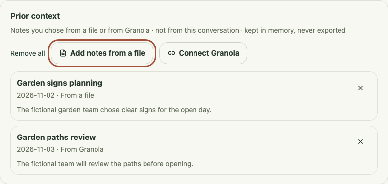
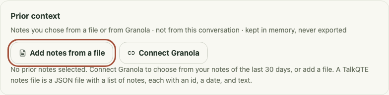

# Imported-note list recovery

11 November 2026. The task is to keep the notebook's displayed prior context consistent with the user's import and removal choices. Prior notes remain optional, separate from the current conversation, and removable without disconnecting a provider.

## Reproduced boundary failure and fix

The native bridge subscribes to complete `context:changed` lists before requesting the startup `context_items` snapshot. A delayed startup reply could arrive after an import or removal event and replace the newer list. In the fictional browser reproduction, **Remove all** emptied the fixture store and the panel; releasing the old reply then displayed both removed notes again. This demonstrates stale UI content, not a failure to delete native data or an observed real-account incident.

The bridge now uses the initial read only if no context event has arrived. Once an event supplies the current list, a late read failure also leaves the subscription attached so subsequent removals remain visible. Without an event, a successful initial read still supplies the list and an initial failure retains the existing cleanup/error behavior. Native commands, context storage, retention, provider access, exports and cue processing are unchanged.

## Acceptance and UI/UX checkpoint

Five scenarios pass in Chromium and WebKit, ten checks in total, against the actual React notebook with fictional native IPC:

- Remove one note, then release a startup list that still contains it.
- Remove all notes from both fixture providers, then release that old list.
- Deliver a new import event before an older empty startup list.
- Reject the startup read after a current event, then remove and import again.
- Deliver an initial list without a preceding event, then remove its notes.

The removal tests check both the fixture's empty/reduced store and the displayed list. New imports in the ordering scenarios are emitted by the fixture; these tests do not establish account-level fetching. Keyboard activation works, and a late reply does not move focus from **Add notes from a file**. The 600 × 700 reduced-motion rendering has no horizontal overflow. The existing appearance, source/date labels, explicit controls and optional setup are preserved.

| Before: removed notes reappear after the old reply                                   | After: the empty list remains current                                                                            |
| ------------------------------------------------------------------------------------ | ---------------------------------------------------------------------------------------------------------------- |
|  |  |

The desktop crops use a 1320 × 880 viewport; the [narrow crop](assets/context-removal-narrow.png) uses the same fictional data. Rendered states were inspected. Frontend compilation, formatting and 33 surrounding Chromium notebook/Granola checks passed; the source design scan reported no findings. These complement the rendered evidence; they do not validate native delivery ordering, VoiceOver, or behavior alongside another app.

The owner subsequently confirmed basic native Granola import/removal on 11 November. Source/date accuracy and absence of unselected notes were not separately reported; account refresh and recovery are the next integration checks. The broader [privacy and recovery gates](granola-import-validation.md#privacy-boundary-checks) and native accessibility acceptance remain open. No account, capture, inference, or VM activity was used for this change.

## Focus after removal

Removing one or all notes from the keyboard moves focus to the stable **Prior context** disclosure before the removal control is disabled or removed. Fictional Chromium and WebKit checks cover both removal routes, removal after a Granola import, and delayed success or failure after the person moves focus elsewhere. A late reply does not pull focus back. Provider access, retained data and removal semantics are unchanged; native VoiceOver and real-account behavior remain separate checks.
