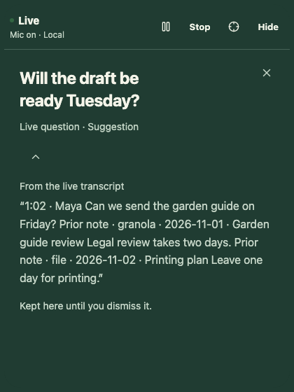
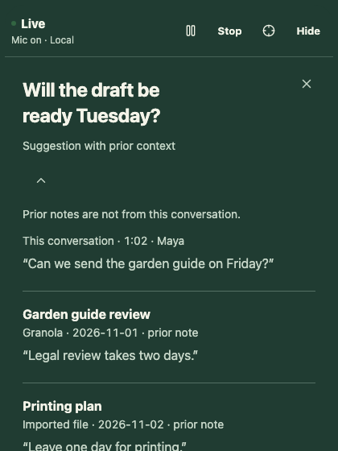

# Bounded cue evaluator

`src-tauri/src/cue_evaluator.rs` provides a replaceable Rust worker and decision contract. A development constructor registers it with the Rust cue engine, disabled until an explicit session grant approves transcript input and any exact prior-note selection. Ordinary builds register no evaluator and keep the existing phrase rules. A development build with the `claude-cli` feature registers one backend, the Claude Code CLI on the owner's own subscription, described in [model-decided cues](cue-model.md); it sends nothing until the person approves the session, and is never sent prior notes.

This foundation supports timely context by rejecting late or obsolete proposals before they can reach the cue lifecycle. Structure and source-membership checks do not establish that a proposal is true, relevant, or useful to someone listening.

## Input and output

The caller constructs an immutable request with a session ID, eligibility revision, selected sources, and optional existing cue. Each source has a unique ID, revision, text, and provenance: transcript time/speaker or prior-note provider/date/title. Imported notes remain distinguishable from current speech. Source text is untrusted data, not instructions or permission to act.

Requests allow 1–32 sources, at most 4,096 bytes of text per source, and at most 32,768 bytes across source text, IDs, and metadata. Source IDs are limited to 160 characters to accommodate a namespace around the context store's 128-byte note IDs. Speaker and date strings allow at most 128 characters; note titles allow 200. Their bytes, including provider labels, count toward the aggregate limit. An existing cue has a bounded ID, at most 240 characters of text, and 1–4 distinct references to supplied sources. JSON encoding adds overhead; adapters must also bound their complete wire input and transport output.

A reply is at most 4,096 bytes of JSON with exactly five fields: `action`, `cue`, `sourceIds`, `reason`, and `observedUse`. Unknown fields, missing fields, invalid types, and duplicate object fields fail validation.

| Action     | Requirements                                                                        |
| ---------- | ----------------------------------------------------------------------------------- |
| `show`     | No existing cue; nonempty cue text of at most 240 characters.                       |
| `quiet`    | `cue: null`; a proposal to remain quiet, not an instruction to clear a visible cue. |
| `resolved` | An existing cue and `cue: null`; resolution remains distinct from observed use.     |
| `withdraw` | An existing cue and `cue: null`; not an automatic failure label.                    |

Every decision cites 1–4 distinct supplied source IDs and has a nonempty reason of at most 300 characters. `observedUse` is `not_observed`, `possible`, or `unknown`; without an existing cue it must be `not_observed`. These are proposed observations, never usefulness or participation scores. A valid source ID proves membership, not that the cited words support the decision.

## Scheduling and lifecycle

One request may be outstanding. Submission and polling do not wait for inference; extra submissions return `Busy` and are not queued. There is no automatic retry, fallback, or replacement worker. The caller must specify a positive budget of at most ten seconds. That ceiling is not a latency target or a measured provider allowance: choose the remaining budget within the [end-to-end latency and freshness targets](budgets.md).

Polling compares the complete current request with the submitted request. A changed session, eligibility revision, source text/revision/provenance, or current cue rejects the result. Results that finish before the deadline but are not polled until after it are also rejected. The caller must poll and apply under the same lifecycle lock, update eligibility for topic/focus/control changes, and cancel on Stop, pause, or dismissal. Rust still owns hold, cooldown, expiry, cue selection, and permission decisions.

Cancellation or expiry returns promptly to the caller. An adapter that ignores cancellation still occupies its worker until it returns; no new evaluation overlaps it. Dropping the worker signals cancellation and does not wait. A worker that exits unexpectedly becomes unavailable instead of staying busy forever. Recovering it requires an explicit caller decision.

Adapters must check cancellation, cap transport buffers, terminate their own subprocess/request when appropriate, and avoid logging private content, including in panic messages. The Rust trait is not an OS sandbox and cannot forcibly stop an arbitrary implementation. Request and decision `Debug` output omit source text, IDs, speaker metadata, and cue/reason text; fixed failure codes contain no provider response.

## Acceptance and remaining work

Eight headless Rust tests use fictional evaluators and channels, without model calls. They exercise all four actions, input/output bounds, malformed and unsupported decisions, unknown or repeated references, changed context and cue identity, cancelled and expired results, an occupied worker, adapter failure, worker exit, and nonblocking teardown. The complete library suite passed 225 tests on 10 November 2026.

The transcript lifecycle bridge below is the next delivered slice. The selected-note development bridge below adds source lifecycle and disclosure; semantic note reasoning and provider/app activation remain separate work. Provider selection, a user-facing permission flow, model quality, actual latency/resource budgets, and comparison with no assistance remain separate gates. These offline tests establish neither semantic quality nor user outcomes.

## Transcript lifecycle bridge

`Engine::live_with_evaluator(worker, processor)` registers one explicitly supplied worker and immutable processor configuration instead of phrase rules, initially without processing permission. Only a `claude-cli` development build constructs it for live sessions ([model-decided cues](cue-model.md)). Other builds and the fictional browser preview keep their current behavior, with no provider selected or inference enabled.

Each newly accepted eligible transcript line requests evaluation with the last six complete, fresh lines and the visible cue's original references (at most four); waiting speech notifications coalesce as described below. The worker's byte bounds still apply; excessive input stays quiet rather than truncating speech or splitting work. Source IDs, times, speaker labels, and exact text come from the engine. Manual notes, imported excerpts, the session name, and focus text are excluded. Focused mode is enforced locally through the existing word-match policy.

New speech, pause/resume, dismissal, Stop/replay, focus, name, sensitivity, or imported-note changes cancel pending work. Reimporting an unchanged selected store does not cancel it. Clock ticks and appearance changes do not cancel a still-current request. Polling and application share the engine's lock with controls; results are checked against current session, eligibility, sources, cue identity, and freshness. New speech arriving while a cancelled adapter is still busy sets one coalesced notification. Once the adapter returns, a clock tick can dispatch the latest current context, without another spoken line. Intermediate requests are never stored or replayed. Controls clear the notification, and completed/failed inputs are not retried. See the scheduling evidence below; uninterrupted speech can still invalidate every result when evaluation is slower than new input.

A `show` proposal can use only the free cue slot. It respects cooldown, Focused mode, and a bounded two-minute exact-text repeat history. Each cited transcript excerpt is shown with its speaker and time. Its 18-second lifetime starts at the newest cited speech, not when the result arrives. Source IDs use a `transcript:` namespace. This is structural grounding and lifecycle validation, not proof of source support or semantic deduplication.

`quiet` leaves the current cue alone, including when use is labelled possible. A sourced `resolved` result clears an unread cue; a held cue retains its words and shows the cited resolution. `withdraw` clears even a held cue whose premise is no longer valid, without calling that premise answered. Transcript eviction removes an affected cue and its copied evidence, including a held cue. Dismissal, cue pause, expiry, and Stop also release those copies. No evaluator reason, observed-use label, or unused suggestion becomes a note, export, or retained score.

Eight additional headless lifecycle tests use fictional delayed replies. They cover ordinary clock ticks, source disclosure and excluded inputs, quiet versus resolution while held, withdrawal, pause/resume without replay, dismissal/cooldown/repeats, Stop/new-session isolation, transcript eviction, stale sources, settings changes, malformed references, Focused filtering, and no rule fallback. No device, account, model, or network input is used.

Bounded catch-up scheduling is implemented below. An explicitly scoped activation path still requires a processing/provider decision. Actual semantic quality, latency under ongoing speech, hardware operation, and useful participation while listening remain unvalidated.

## Selected-note development bridge

The earlier selected-note constructor has been replaced by the session permission boundary below. A grant defaults to no notes and can approve exact provider/ID/revision selections from the imported store; importing another note never expands it. The `claude-cli` development backend refuses any note selection, so this path is exercised only with fictional evaluators in tests. No production provider is selected.

The request includes the same recent speech and original cue references, plus up to twenty explicitly approved notes. Each note keeps its complete excerpt, title, provider, source date, and revision. IDs use `prior:<provider>:<source-id>` so file notes, Granola notes, and transcript segments cannot collide. Manual notebook edits, raw focus/name settings, unselected provider notes, and credentials are excluded. A note update does not schedule work by itself.

Existing per-source and 32 KiB aggregate bounds apply to the entire selection. An oversized selection or multibyte excerpt fails closed without truncation, batching, a retry, or partial context. A future activation flow must explain these input limits and unavailable evaluation; silently implying active assistance would be wrong.

Every state-changing decision must cite fresh speech in addition to any notes. An earlier note alone cannot raise a cue or establish that this conversation answered or corrected it; fresh speech elsewhere in the request is insufficient. Focused-mode matching uses cited speech, not prior-note wording. These are structural guards, not semantic evidence that the cited words justify a decision.

Cue and resolution snapshots disclose all cited sources separately, at most four each, with exact excerpts. A prior note displays its title, provider, and date; a transcript excerpt displays its speaker and session time. Only cited sources reach the companion. Mixed resolution is labelled as resolved from its sources instead of attributing all of it to the conversation. The complete question and disclosure/hold/dismiss controls remain. Long source text scrolls with the existing companion surface; native window and assistive-technology checks remain open.

Changing or removing any cited note clears the cue and copied disclosure, even while held or when that note was cited only by a resolution. Unchanged and unrelated imports leave visible evidence intact. Changed context cancels pending proposals; a delayed response cannot restore the removed revision. An adapter already executing still owns its request until it cooperatively returns, as described under cancellation above. Nothing is retained in notes or exported automatically.

Five additional fictional Rust tests cover mixed/provider-colliding IDs, disclosure order and exclusion of uncited text, fresh cited speech, revision/removal during delayed work, held original/resolution evidence, input size failure, and maximum supported IDs/titles. The complete library suite passes 243 tests. Headless Chromium checks cover keyboard disclosure, distinct source labels, resolution/removal, and four long citations at 320 px with larger text. Local WebKit pointer actions also time out in unchanged controls; Linux browser CI remains required before merge. These checks do not prove real-account import, native placement, semantic quality, or user benefit.

Fictional browser evidence (420 × 560 companion viewport; longer disclosure scrolls):

| Previous single-quote rendering of mixed input                                            | Separate source disclosure                                                                         |
| ----------------------------------------------------------------------------------------- | -------------------------------------------------------------------------------------------------- |
|  |  |

[320-pixel companion rendering](assets/evaluator-sources-narrow.png).

The bounded scheduling check below is complete. Next readiness check: review an explicit processing/provider choice and its actual latency, privacy, cost and onboarding behavior. The planned no-assistance comparison still needs people and must measure listening together with useful participation.

## Coalesced speech scheduling

The original development bridge lost the final eligible line when it arrived while a cancelled adapter was still occupied. Clock ticks only polled pending work, so the engine could remain quiet forever after that adapter returned, even when the latest speech was still fresh. A regression test reproduced this before the change.

The engine now remembers one boolean notification that newer eligible speech is waiting. It stores no queued request, source copy, or per-line backlog. Further speech replaces that notification and still cancels the obsolete attempt. Once the same worker is free, the next normal clock poll constructs one request from current sources and current cue state. There is no second worker, overlapping call, fallback, or retry of a completed/failed input. Oversized or stale context consumes the notification without running it. Stop, pause/resume, dismissal, focus/name/sensitivity and changed-note synchronization discard it; new eligible speech is required to request work again.

Four new headless tests and the updated eviction test use fictional dialogue, a controlled speech clock, and explicit reply gates. The complete Rust library suite passes 247 tests; all-target Clippy and Rust formatting checks also pass. No model, device, account, or network input is involved. These are scheduling measurements, not provider latency or semantic-quality measurements:

| Controlled scenario                                                                                                                     | Observed acceptance                                                                                                                                                                                                                        |
| --------------------------------------------------------------------------------------------------------------------------------------- | ------------------------------------------------------------------------------------------------------------------------------------------------------------------------------------------------------------------------------------------ |
| 25 lines; initial adapter withheld through six seconds of fictional speech                                                              | Exactly two requests: the initial attempt and one latest-context catch-up. The final line is evaluated without another line arriving; the obsolete reply never appears.                                                                    |
| 25 lines at 250 ms, 1,000 ms and 3,000 ms spacing; three gated returns after eight more lines each                                      | Four requests per scenario, with at most one adapter call occupied. Each new request contains at most six recent lines and includes the latest line. The three superseded replies stay invisible; only the final current proposal appears. |
| Pause/resume, Stop/new session, dismissal, focus/name/sensitivity change, note revision/removal, and freshness expiry while input waits | No deferred request starts and no cancelled resolution is applied.                                                                                                                                                                         |
| Latest dispatched input returns malformed output or exceeds its deadline                                                                | The availability boundary below now reports failure and revokes permission; neither ticks nor new speech restart processing without fresh approval.                                                                                        |
| Transcript eviction during a held cue and occupied evaluation                                                                           | Old evidence clears; one current context is evaluated, without replaying intermediate inputs or the evicted cue.                                                                                                                           |

Catch-up removes a scheduling gap; it does not make an old answer current. If every evaluation is overtaken by speech, no proposal is applied until a result completes against unchanged, fresh input. Source ageing can also invalidate a request even without new speech. Accepting older output merely to increase cue count would require separate relevance validation. A non-cooperative adapter still blocks its worker indefinitely; the notification adds no copied content and cannot bypass that stall.

The next release dependency is an explicit processing/provider path and permission flow before activation. On that path, measure cancellation responsiveness, request volume, skipped opportunities and trigger-to-visible latency under sustained speech and realistic pauses against [the budgets](budgets.md), including a source-backed already-answered/topic-change check. No production provider or implicit inference is enabled here. Compare useful participation and listening with no assistance separately; fictional scheduling success does not establish either outcome.

## Session processing permission

Implemented and checked with fictional adapters on 10 November 2026. Registration alone sends nothing. `review_processing` prepares a Rust-only, single-use review for one engine instance, session, permission generation and immutable processor configuration. The configuration identifies the adapter/model/version, on-device or named hosted destination, and policy revision. It is supplied by trusted Rust adapter registration, not deserialized from a webview; this contract does not verify an adapter's honesty or provide an OS sandbox.

A review explicitly chooses new speech only or recent and new speech, plus zero or more exact prior-note selections. Unknown IDs, wrong providers/revisions, duplicate selections, more than twenty notes and oversized note scope fail as a whole. The review holds SHA-256 fingerprints of the complete note content and provenance rather than excerpt copies. Approval rechecks them against the current store before installing an in-memory grant. A stale review cannot restore an earlier selection or move to another engine, session or processor configuration.

New-speech-only permission starts after the confirmation clock time, excluding earlier or delayed buffered transcript lines. Explicit recent-speech approval can request the existing fresh six-line window immediately. Both retain the existing freshness, pause, source and aggregate bounds. Adding an unapproved note cannot widen the grant. Changing or removing any approved note, including text/title/date changes without a revision bump, revokes the entire grant and requires a new review. Scope changes cancel pending work and clear copied cue evidence, including held cues.

Dispatch checks the grant and builds input only from approved sources. Polling checks its permission generation as well as the complete current request under the same engine lock before applying a reply. Revocation discards waiting speech, caller-owned pending input, grant excerpts and cue copies. It leaves capture state, the notebook, transcript and imported store intact. Stop and session restart revoke permission; no grant is copied into a replacement engine. Pause cues cancels and clears pending/displayed work while preserving the still-valid grant, and Resume permits only newly spoken input. A running adapter may retain its request until it returns; cancellation cannot retract an upload or forcibly stop arbitrary Rust code.

Seven new headless tests plus the migrated lifecycle/source tests pass; the complete Rust suite passes 254 library tests. All-target Clippy and Rust formatting also pass. Acceptance covers zero adapter calls before approval or after revocation/restart, explicit recent versus new speech, exact selected metadata, stale source/configuration reviews, atomic scope rejection, delayed replies across revocation/reapproval, and oversized combined context without a partial dispatch. Existing source tests additionally confirm that changing approved notes clears held disclosure and prevents subsequent submissions. No model process, account, microphone or provider request ran.

The fictional [processing-control flow](processing-controls.md) now covers location, source selection, availability, continuing capture, Pause/Resume, disable and Stop, with headless keyboard and narrow-layout checks. Native IPC, a concrete adapter, authentication/allowance recovery and app activation remain separate. The native binding and [remaining provider and outcome gates](processing-plan.md#acceptance-and-dependency-order) must be verified before evaluated cues are offered for real conversations.

## Evaluation availability before native controls

The development engine exposes content-free `EvaluationStatus`: idle, pending, a validated decision (quiet, shown, resolved or withdrawn), or unavailable with an input-limit, invalid-reply, timeout or worker-unavailable code. An engine without an evaluator reports no status. Idle does not mean permission is enabled, and a missing cue, rejected proposal or cancelled request is never labelled as a quiet decision. These states are Rust-only until the native controller is implemented.

New input, source changes and eligibility controls clear the previous decision; it also expires when its latest speech source is eighteen seconds old. Observable changes advance the session snapshot revision, including quiet replies that do not alter any cue. A quiet decision can coexist with a held question and never marks it resolved. Provider reasons and observed-use labels are not retained in this operational state.

Oversized combined input fails before dispatch without sending a subset. A current malformed reply, deadline or worker failure revokes the grant and pending reviews, cancels pending/waiting work and clears copied cue evidence. The unavailable code remains through subsequent speech and Pause/Resume. Capture, transcript ingestion, manual notes and the imported store continue. Recovery requires a fresh review and explicit approval; an older review cannot restart processing. A stopped worker is not replaced automatically, even after reapproval. Cancellation, supersession, freshness expiry and lifecycle suppression are ordinary eligibility outcomes, not provider failures.

Headless fictional tests cover quiet publication without a clock tick, decision expiry and invalidation, distinct shown/resolved/withdrawn observations, rejected proposals, malformed/late replies, timeout, adapter error, worker exit, stale review rejection, continued capture/notes, no restart on new speech, and explicit recovery with reduced source scope after an aggregate limit. The complete Rust suite passes 257 library tests. No provider, model, microphone or account is used.

The next dependency is still the native command/event controller: bounded opaque review IDs, source/session authority, monotonic events across engine replacement and processing revocation before Stop drains audio. The controls remain mounted only in fictional UI tests. This status boundary does not enable inference or establish provider reliability, semantic quality, accessibility or useful participation.
