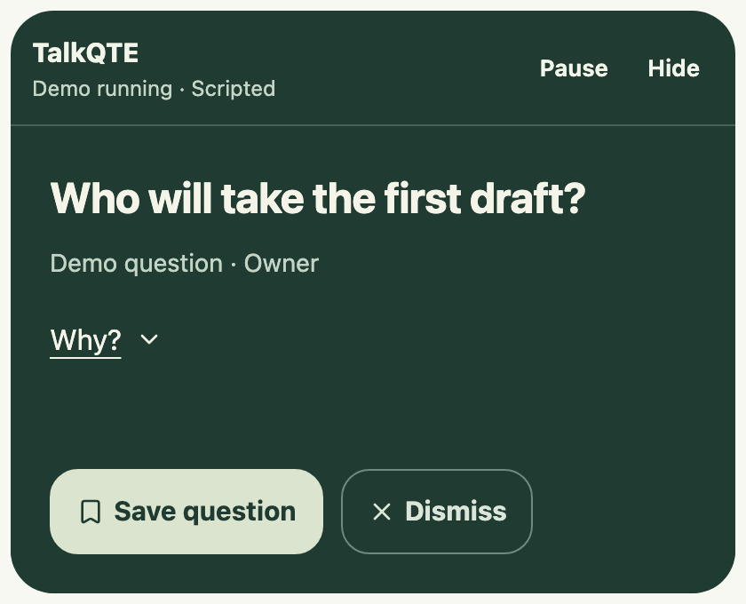
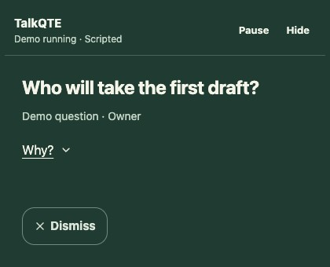

# Glance view: design and evidence

Reviewed 8 November 2026. This note records why TalkQTE uses a compact question by default, which findings informed the design, and what still needs testing. It is research-informed product design, not evidence that TalkQTE improves eye contact, accessibility, or meeting outcomes.

## What the prototype does

Glance view shows one complete question. **Why?** reveals the exact fictional transcript excerpt that triggered it and holds that same question for reading; while the context is open the same control is a chevron labelled Hide context, and hiding the context does not release the hold. Dismiss is a small cross in the question's corner, so the question itself is the only large element (9 November 2026, after the owner found the full-width Dismiss and the downward growth of the context heavy in a live session; the companion now opens 120 CSS px taller for context instead of 160, and 100 px more when an answer is shown). Dismiss remains available while the demo is paused and after playback finishes. Explicitly ending or replaying the demo clears the current question. Untouched questions still expire quietly; there is no visible countdown, scrolling script, or word-by-word animation.

Held questions do not block transcript playback or replace their text with later suggestions. Once their original time window passes, they are labelled as earlier in the demo. That label is based on elapsed time. When a later line matches a fixed answer pattern, a held question instead says it was answered in the conversation and shows that line in its context; the companion grows to fit. The match is phrase-based, not an understanding of the answer. Skipped suggestions are not queued for later display.

Settings offers standard or larger question text and bottom-right, top-center, top-left, or top-right companion placement. Bottom-right remains the default. Top-center is an optional near-camera starting point, not automatic camera detection or calibration. The companion follows the notebook's display and stays within its work area; move the notebook to choose another display. Appearance choices last for this app session, including demo replays, and reset on quit.

The companion is configured to remain passive and not take keyboard focus. The same question, disclosure, Dismiss action, and settings are available through the notebook. A native notebook smoke check covered question arrival, keyboard disclosure, and the former Save action while paused; it does not establish cross-app focus or complete keyboard accessibility. Native placement, VoiceOver, and cross-app behavior remain pending in the [native validation record](native-validation.md). No camera permission, gaze tracking, video alteration, or new microphone behavior is involved.

## Prototype appearance

These browser renderings use only the bundled fictional demo at a 420 × 340 CSS-pixel viewport. The current companion removes the light outer background and Save action. The captures show appearance, not native placement or focus behavior.

| Before                                                                          | Current companion                                                                                           |
| ------------------------------------------------------------------------------- | ----------------------------------------------------------------------------------------------------------- |
|  |  |

When a held question is answered by a later line, the companion keeps it and shows the answer. These browser captures use the bundled fictional demo at 51 seconds, a 420 × 600 CSS-pixel viewport, and reduced motion. The native details window grows to the same height; that size has not yet been checked on a Mac display.

| Before: held question, no answer shown                                                       | After: answer shown with its source                                                                              |
| -------------------------------------------------------------------------------------------- | ---------------------------------------------------------------------------------------------------------------- |
|  |  |

Earlier design references: [always-visible source](assets/glance-before.png) and [expanded context](assets/glance-context.png). Those historical captures still show the former Save action.

## What informed the choices

| Evidence                                                                                                                                                                                           | Relevant finding and limit                                                                                                                                                                                                | Design implication, not a tested TalkQTE result                                                                        |
| -------------------------------------------------------------------------------------------------------------------------------------------------------------------------------------------------- | ------------------------------------------------------------------------------------------------------------------------------------------------------------------------------------------------------------------------- | ---------------------------------------------------------------------------------------------------------------------- |
| [Gao et al. (2025), _Don't look at the camera: Achieving perceived eye contact in remote video communication_](https://pmc.ncbi.nlm.nih.gov/articles/PMC12439499/)                                 | Seventeen observers judged photographs of three actors. Looking about two degrees below the lens produced the strongest perceived eye contact in that setup. The experiment did not test live prompt reading.             | Offer placement near the camera, but do not prescribe a universal pixel offset or promise invisible reading.           |
| [Horstmann and Linke (2022), _Perception of direct gaze in a video-conference setting: the effects of position and size_](https://link.springer.com/article/10.1186/s41235-022-00418-1)            | Their experiments found a slightly upward optimum and effects of on-screen position and size. The setup differs from Gao et al.                                                                                           | The differing results favor user choice and setup-specific testing over a fixed “correct” gaze position.               |
| [Ho, Foulsham, and Kingstone (2015), _Speaking and Listening with the Eyes: Gaze Signaling during Dyadic Interactions_](https://journals.plos.org/plosone/article?id=10.1371/journal.pone.0136905) | In eye-tracked social guessing games, speakers tended to end turns looking at their listener; listeners began speaking with averted gaze. This is conversational evidence, not a teleprompter trial.                      | Preserve natural looking away. Do not score sustained eye contact, attention, or honesty.                              |
| [Garvey et al. (online 2024; journal volume 2025), _Deliberate and Self-Conscious Adaptation of Eye-Contact by Autistic Adults_](https://link.springer.com/article/10.1007/s10803-024-06296-4)     | Interviews with nine autistic adults describe varied experiences, including effort, listening difficulty, and social pressure around eye contact. This small qualitative study does not establish a universal preference. | Make placement and reading controls available without requiring a diagnosis or pressuring users to look camera-facing. |

W3C's [Pause, Stop, Hide guidance](https://www.w3.org/WAI/WCAG22/Understanding/pause-stop-hide.html) explains the need for control over information that changes alongside other content. It motivates stable disclosure and pause controls. Its [Text Spacing guidance](https://www.w3.org/WAI/WCAG22/Understanding/text-spacing.html) motivates layouts that tolerate users' spacing adjustments. These are accessibility design references, not a claim of WCAG conformance for the desktop app.

**The default is a product judgment.** Showing the complete question while deferring its supporting excerpt reduces the amount presented at once without compressing meaning into a fragment such as “Owner?”. None of these studies proves that this default reduces visible reading or cognitive load. The existing demo questions are already short, so this version preserves their wording. Larger text can also need more space; the window grows and can scroll when the available display area is small.

## What should be tested next

Use fictional conversations to compare the same complete question in the current corner, the same question near the user's camera, and optional keyword wording with full-question disclosure. Include a no-prompt baseline, counterbalance presentation order, and keep prompt content and timing controlled. A small formative trial can find problems; it cannot establish general efficacy or disability-specific benefits.

Prioritize listening comprehension, correct interpretation of the question, useful clarification, control discoverability, and comfort. Check larger text, keyboard operation, native VoiceOver, smaller work areas, external monitors, and display changes. Evaluate apparent reading only as a secondary outcome with separate consent for any recording. Keep placement optional if its value varies; drop keyword compression if it changes meaning.

Actual eye correction changes outgoing video and is a separate opt-in capability. It is not implemented by Glance view. No claim that reading is hidden, that eye contact is improved, or that an accessibility outcome is proven should be added without suitable evaluation.

For a broader update, use the [reusable deep research prompt](research-prompt.md). It covers participation, timing, accessibility, gaze, speech recognition, trust, privacy, and supported integrations, with evidence-quality and scope checks.

The [broader review summary](research.md#what-the-broader-review-adds) records the participation/listening tradeoff, maps recommendations to the current code, and prioritizes a human-cued comparison before automatic detection.
