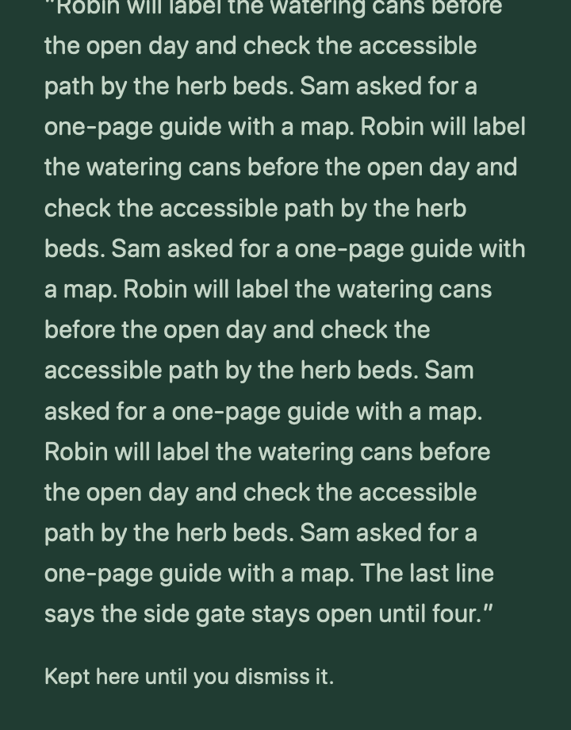
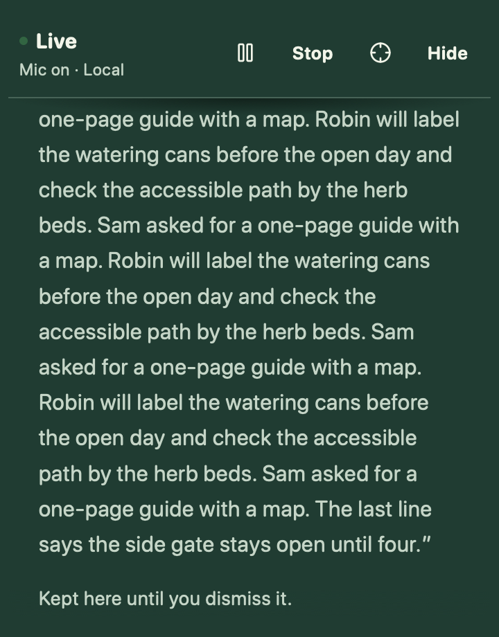
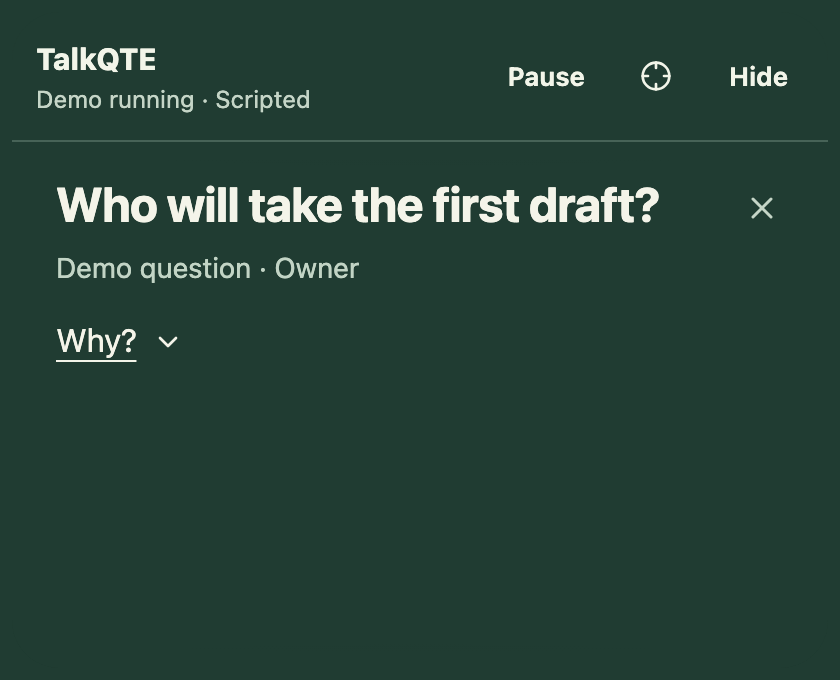
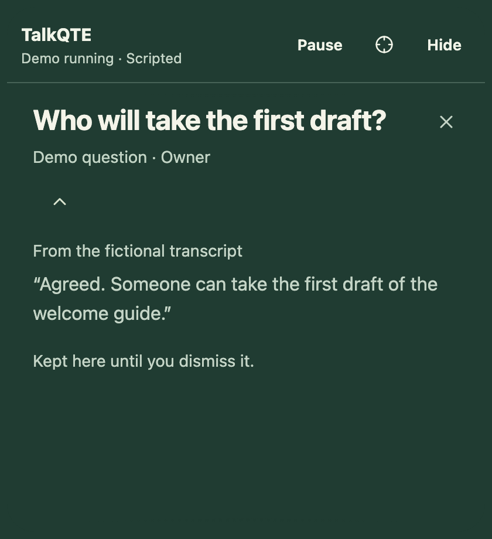
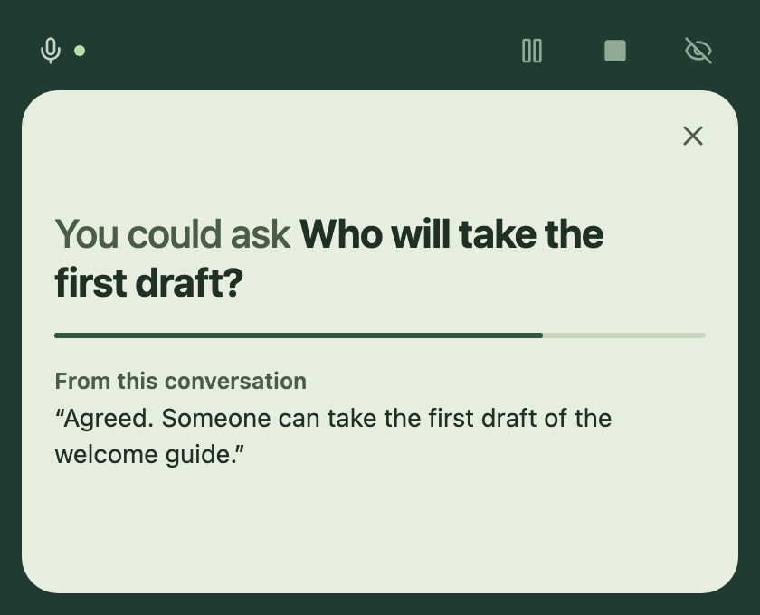
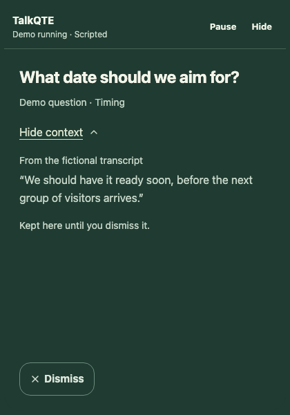
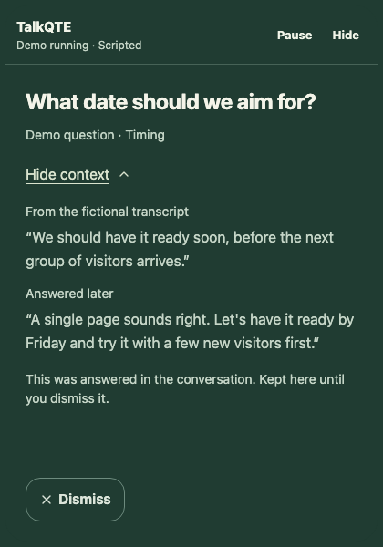

# Glance view: design and evidence

Reviewed 8 November 2026; the card was redesigned on 14 November 2026. This note records why TalkQTE shows one compact cue, which findings informed the design, and what still needs testing. It is research-informed product design, not evidence that TalkQTE improves eye contact, accessibility, or meeting outcomes.

## What the prototype does

Glance view shows one complete cue, meant to be understood without a click. Its first words say what it is: "You could ask" for a suggested question, "Just said" for a quoted date or commitment, "Asked you" for a question put to you by name, "From your notes" for a reminder. Under it the card names where the cue came from and quotes it: the line from the demo or the live conversation, or the imported note and its date. Where the cue is itself words from that line (a quoted date, a question put to you), the card repeats only the rest of the line, with an ellipsis in their place. A reminder from a note the last update check could not confirm still says "Not verified" and when it was last confirmed. Nothing on the card calls a phrase-rule cue AI or claims the conversation was understood.

A thin line between the cue and its source shows how long an untouched cue has left. It has no numbers and gives no warning as it runs out; it stops while the demo is paused. The line is also the **Hold** control: pressing it keeps the cue until it is dismissed, and the line then fills and rests. The word Hold shows only when the pointer or keyboard is on the card. An "Asked you" question shows no line, only the words "Stays longer · no countdown"; it still leaves after 45 seconds untouched. Dismiss is a small cross in the corner. Dismiss and Hold remain available while the demo is paused and after playback finishes. Explicitly ending or replaying the demo clears the current cue. Untouched cues still expire quietly; there is no countdown in numbers, scrolling script, or word-by-word animation.

A new cue comes in from the left and opens sideways to its full width in about half a second. Its words are in place from the first frame and darken one by one. Words read on the card (the purpose, a suggested question, a note excerpt) darken in reading order and are fully dark within three quarters of a second. Words that were spoken (a "Just said" quote, the quoted line under a cue, a later answer) wait at a readable strength and darken at about the pace they were said, to show that they were just said. The time line has a small bead at its moving end. With reduced motion there is no animation, every word is dark at once, and the time line moves in four steps. A cue first shown already held does not replay.

**What the spoken replay can and cannot time.** The engine gives each transcript line one time and no timing for its words or its length, so the card cannot follow the speaker. It replays the line at an even pace of 60 ms a letter (about 160 words a minute) from the moment the card opens, and a line that would take longer than six seconds is compressed to six. In a live session a line reaches the card only after local transcription, a median of 3.1 to 5.1 seconds after it began in the [synthetic measurements](local-transcription.md#sustained-session) on one Mac, so the replay always runs behind the speech and never ahead of it. Following the speaker's own timing would need the transcriber's word or segment times passed through the engine to the card, which is not built.

### 14 November 2026: source and time in view

Until this date the card showed the question alone, and **Why?** opened its source and held it. After trying the voiced demo in the desktop preview, the owner found that the card gave no reason for showing a cue, that opening Why? changed its height a great deal and left it mostly empty, and that it had no arrival animation and nothing to show how long a cue would stay. The owner's decision: the card should need a glance and no click, say its purpose at once, carry few controls, and arrive by opening sideways.

This reverses the earlier default of showing the source on demand, which was a product judgment that less on the card would cost less attention. Neither arrangement has been tested with users. The card now carries more words while someone is listening, and a line that visibly runs down is closer to a countdown than the earlier card allowed; whether either costs attention or adds pressure is unknown. An "Asked you" question keeps no line for that reason ([U4](../ROADMAP.md#first-usable-version)). The comparison under [What should be tested next](#what-should-be-tested-next) should include the source in view against the source on demand, and the time line against none.

Live sessions have a separate **Pause cues** control in both windows. It clears even a held cue while microphone and transcript continue; Resume waits for new speech instead of replaying the pause. The compact status makes the continuing microphone explicit. This differs from freezing the fictional demo; see the [behavior and headless acceptance](live-cue-pause.md).

Held questions do not block transcript playback or replace their text with later suggestions. Once their original time window passes, their source is labelled as from earlier in the demo. That label is based on elapsed time. When a later line matches a fixed answer pattern, a held question instead says it was answered later in the conversation and quotes that line above its source; the companion keeps its size. The match is phrase-based, not an understanding of the answer. Skipped suggestions are not queued for later display.

Settings offers standard or larger question text and bottom-right, top-center, top-left, or top-right companion placement. Bottom-right remains the default. The question window is 420 CSS px wide on most displays, 360 when the display's work area is narrower than 1100 logical px and 480 when it is wider than 2400, so a question keeps to roughly 20 to 30 characters a line (an estimate) without covering more of a small screen than it must (9 November 2026). The companion can also be dragged by its top bar (9 November 2026); a dragged position is kept for the session, pulled back inside the display's work area when the window grows for context, and replaced when a preset is chosen in Settings. Top-center is an optional near-camera starting point, not automatic camera detection or calibration. The companion follows the notebook's display and stays within its work area; move the notebook to choose another display. Appearance choices last for this app session, including demo replays, and reset on quit.

The companion window is one size for a cue, 340 CSS px tall (420 with large text), whether or not the cue is held or answered. A short cue sits in the middle of the card, and holding it moves nothing. When a later line answers a held cue, the answer is added above the source and the text moves up to make room. A long cue is set smaller so the whole of it shows (one step past 90 characters, two past 140; the engine allows 200). When the sources under it do not fit, the words scroll inside the card: the bar with Stop stays at the top of the window, the card's edges and Dismiss stay where they are, the card opens at its top with the cue and Hold in view, and keys pressed on a focused cue action scroll the words. At an edge with more to read the words fade into the card, so no line is shown cut in half. Nothing is shortened or dropped. In the 360 px window the cue is set a step smaller. Browser checks in `tests/companion-fit.spec.ts` cover a question, a Said quote, an Asked you question and a note reminder at 360 and 420 px wide, in standard and large text. They assert that the purpose and the source are in view with nothing pressed, that the window never scrolls, that a cue of ordinary length shows everything without scrolling, and that holding it moves neither the cue nor its source. A 25-word suggestion with two sources, and a 200-character cue, must show the whole cue at both widths and text sizes, fade what does not fit, and keep every source reachable. A held cue with an answer, and a reminder with a warning at 360 px, only have to keep every line reachable. Wrapping depends on the platform's fonts, so CI's Linux fonts are the deciding check, and the native window on a small Mac display is unchecked. The live layout preview's Real Cue still has Why?, which makes the native window taller; that control is due to change to match.

These earlier browser captures show the previous card: a fictional note reminder with a long excerpt at 360 × 460 CSS px, scrolled to its end with the End key.

| Before: the whole window scrolled and the bar left view                                                                                | After: the card scrolls and the bar stays                                                                                                |
| -------------------------------------------------------------------------------------------------------------------------------------- | ---------------------------------------------------------------------------------------------------------------------------------------- |
|  |  |

The companion is configured to remain passive and not take keyboard focus. The same cue, Hold, Dismiss action, and settings are available through the notebook. A native notebook smoke check covered question arrival, keyboard disclosure, and the former Save action while paused; it does not establish cross-app focus or complete keyboard accessibility. When a question is dismissed from the keyboard inside the companion, focus moves to the companion's first remaining control; this applies only while the companion already has keyboard focus, and a question that expires or is dismissed from the notebook moves nothing. Browser checks cover this; whether the native companion window ever holds keyboard focus is part of the pending native checks. Native placement, VoiceOver, and cross-app behavior remain pending in the [native validation record](native-validation.md). No camera permission, gaze tracking, video alteration, or new microphone behavior is involved.

## Prototype appearance

These browser renderings use only the bundled fictional demo at a 420 × 340 CSS-pixel viewport, with reduced motion; the opened card before the change needed 460. They show appearance, not native placement, focus behavior or the arrival.

| Before: the question alone                                                                          | Before: Why? opened, 120 px taller                                                                                     | After: purpose, time and source in view                                                                                                    |
| --------------------------------------------------------------------------------------------------- | ---------------------------------------------------------------------------------------------------------------------- | ------------------------------------------------------------------------------------------------------------------------------------------ |
|  |  |  |

Earlier companions: [full-width Dismiss](assets/companion-simple-cues.jpg) and [corner Dismiss with Why?](assets/companion-light-controls.png).

When a held question is answered by a later line, the companion keeps it and shows the answer above its source, at the same window size. These earlier browser captures show the previous card in that state, using the bundled fictional demo at 51 seconds, a 420 × 600 CSS-pixel viewport, and reduced motion.

| Before: held question, no answer shown                                                       | After: answer shown with its source                                                                              |
| -------------------------------------------------------------------------------------------- | ---------------------------------------------------------------------------------------------------------------- |
|  |  |

Earlier design references: [always-visible source](assets/glance-before.png) and [expanded context](assets/glance-context.png). Those historical captures still show the former Save action.

## What informed the choices

| Evidence                                                                                                                                                                                           | Relevant finding and limit                                                                                                                                                                                                | Design implication, not a tested TalkQTE result                                                                        |
| -------------------------------------------------------------------------------------------------------------------------------------------------------------------------------------------------- | ------------------------------------------------------------------------------------------------------------------------------------------------------------------------------------------------------------------------- | ---------------------------------------------------------------------------------------------------------------------- |
| [Gao et al. (2025), _Don't look at the camera: Achieving perceived eye contact in remote video communication_](https://pmc.ncbi.nlm.nih.gov/articles/PMC12439499/)                                 | Seventeen observers judged photographs of three actors. Looking about two degrees below the lens produced the strongest perceived eye contact in that setup. The experiment did not test live prompt reading.             | Offer placement near the camera, but do not prescribe a universal pixel offset or promise invisible reading.           |
| [Horstmann and Linke (2022), _Perception of direct gaze in a video-conference setting: the effects of position and size_](https://link.springer.com/article/10.1186/s41235-022-00418-1)            | Their experiments found a slightly upward optimum and effects of on-screen position and size. The setup differs from Gao et al.                                                                                           | The differing results favor user choice and setup-specific testing over a fixed “correct” gaze position.               |
| [Ho, Foulsham, and Kingstone (2015), _Speaking and Listening with the Eyes: Gaze Signaling during Dyadic Interactions_](https://journals.plos.org/plosone/article?id=10.1371/journal.pone.0136905) | In eye-tracked social guessing games, speakers tended to end turns looking at their listener; listeners began speaking with averted gaze. This is conversational evidence, not a teleprompter trial.                      | Preserve natural looking away. Do not score sustained eye contact, attention, or honesty.                              |
| [Garvey et al. (online 2024; journal volume 2025), _Deliberate and Self-Conscious Adaptation of Eye-Contact by Autistic Adults_](https://link.springer.com/article/10.1007/s10803-024-06296-4)     | Interviews with nine autistic adults describe varied experiences, including effort, listening difficulty, and social pressure around eye contact. This small qualitative study does not establish a universal preference. | Make placement and reading controls available without requiring a diagnosis or pressuring users to look camera-facing. |

W3C's [Pause, Stop, Hide guidance](https://www.w3.org/WAI/WCAG22/Understanding/pause-stop-hide.html) explains the need for control over information that changes alongside other content. It motivates stable disclosure and pause controls. Its [Text Spacing guidance](https://www.w3.org/WAI/WCAG22/Understanding/text-spacing.html) motivates layouts that tolerate users' spacing adjustments. These are accessibility design references, not a claim of WCAG conformance for the desktop app.

**The default is a product judgment.** The card shows the complete cue and the line it came from, not a fragment such as “Owner?”. Until 14 November 2026 the excerpt was deferred to reduce the amount presented at once; the owner's [decision of that date](#14-november-2026-source-and-time-in-view) puts it in view so the cue explains itself. None of these studies proves that either arrangement reduces visible reading or cognitive load. The existing demo questions are already short, so this version preserves their wording. Larger text can also need more space; the window is taller for it, and a long cue scrolls inside the card.

## What should be tested next

Use fictional conversations to compare the same complete question in the current corner, the same question near the user's camera, and optional keyword wording with full-question disclosure. Compare the source in view with the source on demand, and the time line with none. Include a no-prompt baseline, counterbalance presentation order, and keep prompt content and timing controlled. A small formative trial can find problems; it cannot establish general efficacy or disability-specific benefits.

Prioritize listening comprehension, correct interpretation of the question, useful clarification, control discoverability, and comfort. Check larger text, keyboard operation, native VoiceOver, smaller work areas, external monitors, and display changes. Evaluate apparent reading only as a secondary outcome with separate consent for any recording. Keep placement optional if its value varies; drop keyword compression if it changes meaning.

Actual eye correction changes outgoing video and is a separate opt-in capability. It is not implemented by Glance view. No claim that reading is hidden, that eye contact is improved, or that an accessibility outcome is proven should be added without suitable evaluation.

For a broader update, use the [reusable deep research prompt](research-prompt.md). It covers participation, timing, accessibility, gaze, speech recognition, trust, privacy, and supported integrations, with evidence-quality and scope checks.

The [broader review summary](research.md#what-the-broader-review-adds) records the participation/listening tradeoff, maps recommendations to the current code, and prioritizes a human-cued comparison before automatic detection.
