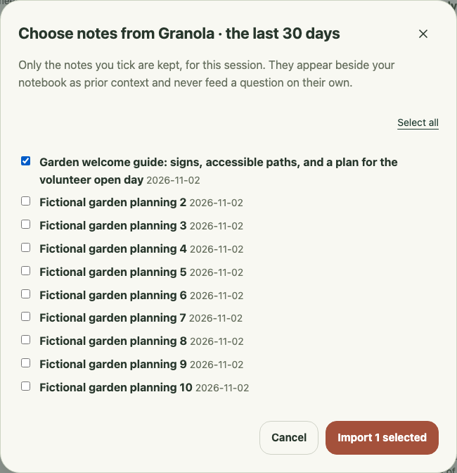
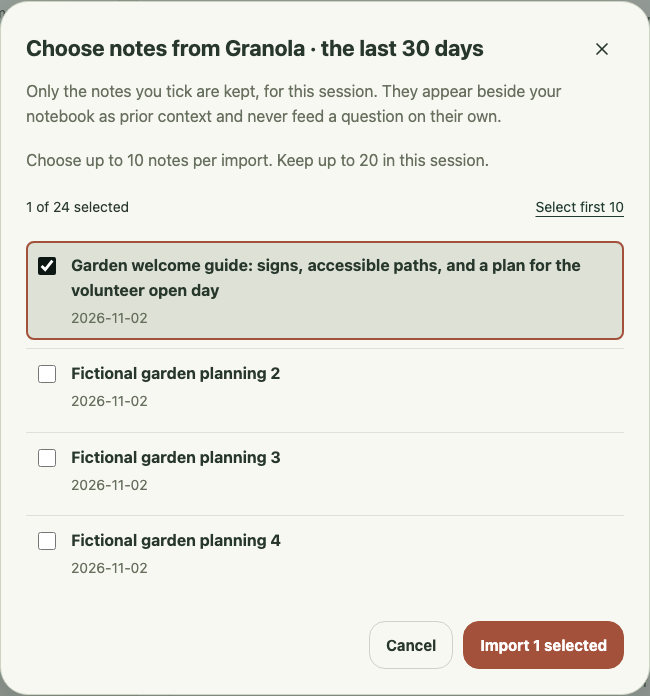
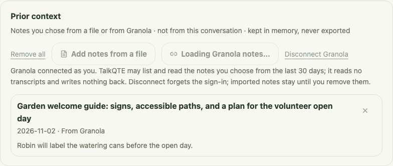
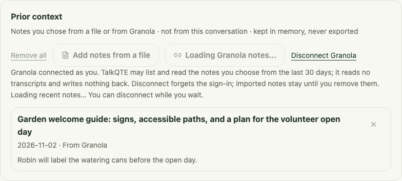
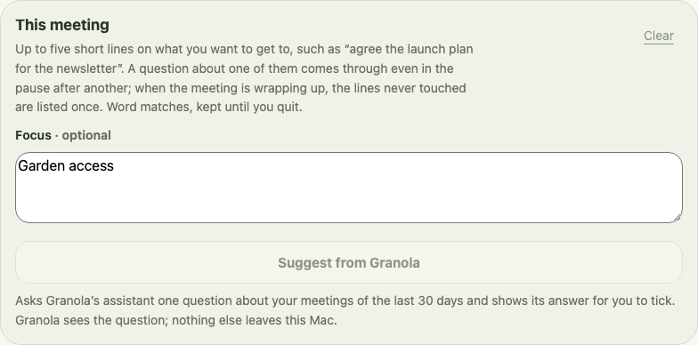
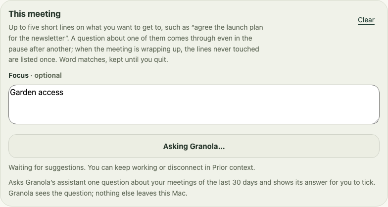
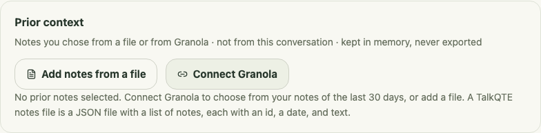
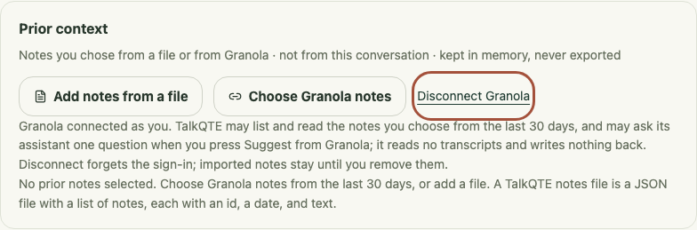
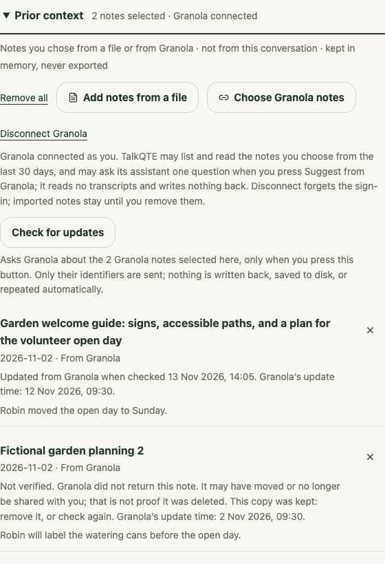

# Granola import recovery check

## Owner-observed native import and removal — 11 November 2026

The owner reports that adding a Granola note and removing it both succeeded in the native app. The development checkout was updated to `d269764` before the check. This establishes a successful basic account import/removal on one Mac, beyond the fictional parser and browser tests. It is an owner observation, not an instrumented account or privacy audit; no private note content, identifiers or screenshot is included here.

Sign-in, listing and requested Focus suggestions had already been observed. This new report does not independently verify displayed source/date accuracy, rejection of unselected provider content, newer/older reimport ordering, disconnect during a real request, or provider/OS retention. Those checks remain explicit integration acceptance work. It also supplies no live transcript input, writeback, meeting-usefulness or user-outcome evidence.

Next account check: deliberately reimport a known updated note, confirm its source/date and absence of duplicates, then verify disconnect/reconnect and failure recovery without retaining private content. The [owner procedure](granola-account-acceptance.md) sets out these steps, with what to record and which roadmap item each settles. Keep existing notebook operation available throughout. Native accessibility and participation/listening validation remain separate.

The dated development checkpoints below retain their original evidence scope. Their references to an unconfirmed first account import describe the state before this owner report.


10 November 2026. The owner confirmed sign-in and note listing work. A compact, content-free account diagnostic now establishes the detail structure: `meetings_data` contains `meeting` entries with metadata attributes and direct `private_notes` and `summary` fields. The parser supports that structure; a successful selected real-note import is still unconfirmed. A build or fictional import is not account-level acceptance.

The chooser now keeps failures inside its dialog, preserves the selection for retry, shows progress, and returns keyboard focus to the control that opened it. Closing, disconnecting, or replacing a pending import invalidates its late result in Rust. Cancellation discards results; an already-sent HTTP request may still finish. No import holds the notebook lock during network work. Granola selection stops at ten notes per request, matching the tool schema; twenty notes can be kept per session.

The design pass keeps the existing paper, evergreen, and terracotta interface. Rows separate titles from dates, show selection, and keep actions visible while the list scrolls. Focus stays in the notebook, is explicitly optional, and does not gate setup completion. Automatically prompting or filling it before a meeting remains a proposal; no model call or meeting detection was added.

These captures contain only fictional garden notes through a test-only native IPC replacement, at a 1320 × 880 browser viewport. They establish appearance, not a working provider connection or native accessibility.

| Before | After |
| --- | --- |
|  |  |

Acceptance evidence: 206 Rust tests passed, including source retention after a failed fetch and invalidation after closing or replacing a chooser. Forty-four headless Chromium/WebKit tests covered the notebook and chooser, including visible failures, selected-note-only mock import, retry without relisting, late-result cancellation, ten-note bulk selection, keyboard operation, and long titles at a 600 × 700 viewport. Build, formatting, and Clippy passed. The Impeccable detector found no mechanical issues; rendered desktop, narrow, and error states were also inspected. Browser tests replace native IPC; they do not verify a real Granola response, native VoiceOver, or capture.

## Tagged detail mapping and headless checks

The detail parser reads only direct private-note and summary fields, labels them separately, decodes XML text references and CDATA, and preserves Markdown as plain text. Empty or unavailable private notes do not hide a summary. Provider notices, attendees, folders, attachments, nested meeting-shaped metadata, and unselected notes are excluded. Requests omit attachment and participant details when the discovered schema supports those arguments. There are no automatic follow-up reads.

Unknown nested content formats, malformed markup, custom entities and duplicate content fields fail explicitly. If any selected ID is absent (for example because of an inaccessible or size-omitted note), no partial selection is imported; the chooser can retry with fewer notes. Known fields with no text are counted as skipped by the store. Excerpts remain capped at 2,000 characters, with private notes before the summary when both exist. Reimporting a Granola note now replaces its copy only when the provider reports a newer `updated_at` timestamp. Repeated or older revisions leave the existing copy intact, including after reconnecting. RFC 3339 timestamps are compared as UTC milliseconds, independent of the meeting date and local clock. Missing, invalid, or pre-epoch timestamps stay unversioned: they can be imported initially but cannot overwrite a known newer copy; remove an unversioned copy first if it needs refreshing.

Acceptance evidence for the mapping: 211 Rust tests passed, including a local fictional MCP server returning the observed tagged structure through the actual import attempt and context store. The selected note arrives with the expected ID, title, date, provider and summary; unselected notes and metadata do not. Additional cases cover private notes plus summaries, unavailable/empty notes, Unicode/XML references, malformed and unknown formats, missing selections, and excerpt limits. Eight headless Chromium/WebKit chooser tests passed for retry, cancellation, keyboard/narrow layout and the selection limit. Browser tests replace native IPC; the Rust check exercises the parser and store but not the native webview command transport.

Repeat the checks without an account or a GUI:

```sh
cargo test --manifest-path src-tauri/Cargo.toml --locked --lib granola::tests
PLAYWRIGHT_PORT=1432 npm test -- tests/granola.spec.ts
```

The Rust tests use only a loopback fictional server and fictional credentials. The browser tests use a dedicated local port and test-only IPC replacement. Neither reads the running app's sign-in, a real account, microphone, or model. This makes parser regressions reproducible headlessly. A final account check still needs the signed-in native app.

Next acceptance check: after restarting the updated app, verify one selected real note appears with its source/date and no unselected notes. If it fails, the optional developer trace emits only a compact content-free outline. Do not copy real note text or screenshots into the repository. Imported context usefulness remains unvalidated; no TalkQTE user-outcome study has been completed.


## Refreshing an imported note

The adapter previously assigned revision `1` to every Granola note, so reimporting could never refresh it. The observed `updated_at` metadata now supplies the revision for tagged details and JSON detail responses (`updatedAt` is also accepted for JSON). Chrono parses the timestamp with timezone offsets; it was already in the dependency lockfile and is now a direct dependency with only its standard-library feature requested.

Headless acceptance uses a fictional MCP server and the actual connection/store path: a newer note replaces its existing copy, repeating it adds no duplicate, an older reply cannot roll it back, and the same instant with a different timezone offset is unchanged. Invalid or missing update times do not invent a version from the meeting date or request order. No extra provider requests, polling, retention, or account access are added. This source-contract check is independent of the outstanding first real-note import confirmation.

## Privacy boundary checks

10 November 2026. An offline review found three gaps: delayed results could survive disconnect/reconnect, developer diagnostics printed raw tool schemas and arbitrary JSON keys, and removing a note did not clear an excerpt already displayed in a reminder. These are corrected independently of the pending real-account import check.

- **Disconnect and reconnect:** fictional MCP responses are held while the old connection is retired and a replacement opens. Listing, suggested focus, and selected-note fetches discard the old response; queued/retained connection copies send no later requests. Idle credentials are dropped immediately, and an in-flight call drops its credentials on completion. Disconnect never waits for that call and does not remove imported copies or revoke provider-side consent.
- **Diagnostics:** tests supply fictional private keys, identifiers, numeric values, tool descriptions, schema defaults, and deeply nested/wide replies. The projection retains only fixed structural names, type/length markers, and collection sizes within depth/node limits. The existing XML outline masks text and attributes. No provider response is logged verbatim.
- **Removal and export:** the engine regression removes the note quoted by an ordinary or held reminder while another imported note remains. Both cue snapshots clear, stale disclosure is rejected, unrelated questions/manual notes remain, and generated Markdown contains no imported excerpt or source ID. The native command publishes the changed cue state to both windows. The browser preview mirrors removal; Chromium/WebKit regressions remove one or all notes while a reminder is held and the demo is paused, then verify the excerpt disappears and stays out of export.
- **Existing boundaries reviewed:** tokens remain behind native commands; OAuth and provider errors use fixed messages; import/list/suggestion commands are available only to the notebook capability, not the companion; the generated export does not traverse the context store. No provider writeback or transcript-read call was added.

Acceptance: eight Chromium/WebKit import/removal checks, frontend build/formatting, and 217 Rust tests passed, including these regressions and the existing import-selection, retry, callback-state and context-store tests. All inputs and credentials were fictional. This is source review and headless regression evidence, not traffic inspection of a real account or native VoiceOver/cross-app validation. A request already sent may still finish; logical deletion does not promise memory zeroization or control over terminal, operating-system, browser or provider retention.

Remaining release checks: confirm one real selected-note import and removal in the native app, inspect an explicitly authorized account session's data flow without retaining content, and verify provider-side disconnect/retention expectations separately. Imported-context usefulness remains a separate human validation task.


### What is established (13 November 2026)

An audit compared each promise in [PRIVACY.md](../PRIVACY.md), the README and these notes with the code. It found two inaccurate statements, both since corrected: sign-in requests carried the HTTP library's user agent instead of `TalkQTE`, and the clip replay tool printed cue text that can repeat recognized speech. The lists below record what evidence each remaining promise has. All tests use fictional accounts, notes and credentials on loopback servers; none uses a real account, microphone or model.

**Established by test**

- **Companion window:** its capability grants no export, note editing, name, focus, import, Granola, model, processing or capture-start command. Its payload carries the cue, that cue's source line and display state, not the notebook, the rest of the transcript, the name, focus lines or an unrelated imported note.
- **Export:** it holds notes and the demo transcript, never the name, focus lines or imported notes. A live session is refused while running and after Stop, and starting one drops an earlier demo preview. (Since the demo was retired on 14 November 2026 the export holds notes only, with no transcript of any kind; a live session is refused only while it runs, and after it ends the notes can be exported.)
- **Interface:** the production content security policy allows connections only to the app's own IPC. In the browser preview, typed notes, focus and a name leave local storage, session storage, cookies, IndexedDB and the Cache API empty, every request goes to the page's own origin, and a reload shows nothing that was typed.
- **Granola requests:** discovery, registration, the token exchange and every MCP request name `TalkQTE` as the user agent. The token travels only as a bearer header, never in an address or body, and is absent from `Debug` output.
- **Disconnect during sign-in:** a sign-in waiting for the browser ends as cancelled without exchanging a code, and a connection that opens after Disconnect is dropped without another request.
- **Connection status:** the notebook receives whether a connection is open, the server's tool names, whether an update check is offered, and the state of kept notes. A listing that names the signed-in account and another participant passes neither to the status nor to the chooser.
- **Files and output:** one whole session (sign-in, listing, a selected note, a focus suggestion, a failed request, disconnect) runs in a child process whose home, app-data and temporary folders point at an empty folder. The folder stays empty and the process prints nothing. With `TALKQTE_GRANOLA_TRACE` set, the trace appears and contains no token, sign-in code, client ID, account, title or note text.
- **Error messages:** provider failures, a refused sign-in, an unreadable or malformed notes file and a missing or damaged model each produce a fixed message with no path, token, account or file content, even when the failing reply or file contains them.
- **Microphone status:** the snapshot both windows receive has six fields: a revision counter, a coarse status and activity, whether Start is available, a message and a display name. It holds no list of samples, no nested device description and no level.
- **Model download:** against a fictional loopback file server, a request is a plain `GET` with no query or body, the `TalkQTE` user agent, a range header only when resuming, and no header beyond those any file request carries. The app's own fetcher refuses a plain-HTTP address before connecting.
- **Live session:** two sessions with a scripted recognizer in place of the speech model (one stopped with a flush, one ended with audio queued) run in the same kind of isolated child process. The folder stays empty and neither the recognized line nor the question it raised is printed.
- **Capture callback:** what the callback runs for each buffer (the activity meter and a live session's audio tap) allocates nothing. Afterwards two different fictional recordings leave identical meter state (a buffer count, a loud flag and a failure flag) and the windows receive the same status from each, so nothing of the audio's content remains beyond whether it was loud. The tap's samples stay in its fixed-size ring until transcribed, as the bounded-buffer tests show.
- **Update check:** it is not offered for a Granola connection, and keeping a note leaves the status unchanged.
- **Earlier checks:** disconnect and reconnect, trace masking, note removal, selection-only import, model checksum and partial-download cleanup, microphone stop and release in synthetic tests, and bounded audio buffers.

**Upheld by code, without a test**

- The macOS adapter's callback calls only the meter and the tap, after converting each sample; the test runs the same two calls on fictional buffers, not the operating system's callback.
- With the real speech model, recognition writes no file: the isolated test replaces the model with a scripted recognizer.
- whisper.cpp's own logging is routed away from stderr.
- A notes file or export destination comes only from a native dialog; no command accepts a path from the interface.
- No telemetry or analytics dependency is present.
- Release is logical: dropped tokens and removed notes are not overwritten in memory.

**Still needing a real account or device**

- Which hosts a real Granola session contacts, how redirects behave, what the provider returns and retains, and what Disconnect leaves at the provider.
- A built app after a real session and after quit: the contents of its data folder, webview storage, and operating-system logs or crash reports.
- Microphone release, permission and device loss on real hardware, and whether the companion is visible to screen sharing.

Limits of the isolated tests: they cover the Granola adapter and the live session runner, not the native command layer, the operating system's capture callback, the speech model or the webview, and they redirect folders through environment variables, so a write to an unrelated absolute path would go unnoticed. No such write exists in either module's source.

## Disconnect while notes are loading

11 November 2026. The notebook previously disabled **Disconnect Granola** while a note listing was pending, even though the native connection already supported retirement without waiting for that request. A headless regression reproduced the disabled control before the fix.

Disconnect now stays available during listing. A short loading status names that option. After a successful disconnect, keyboard focus returns to **Connect Granola**, imported copies remain, and file import is available again. The old listing cannot reopen the chooser, report an obsolete error, or clear a replacement connection's loading state. A failed disconnect leaves the connection visible and offers an explicit retry. The native retirement and HTTP behavior are unchanged: a request already sent may finish, but its retired result is discarded.

UI/UX checkpoint: the task is to leave an optional provider wait and return to the conversation without losing selected prior context. The existing notebook appearance is preserved. Fictional native-IPC replacements cover a delayed success, delayed failure across reconnect, failed-disconnect retry, retained imports and keyboard focus. All 54 Granola/notebook checks passed in Chromium and WebKit; the narrower loading flow was checked at 600 × 700 with reduced motion, without horizontal overflow. The frontend build, formatting and mechanical design scan passed. The scan reported no findings; rendered states were also inspected.

These cropped browser captures use fictional garden notes at a 1320 × 880 viewport:

| Before: Disconnect disabled during listing | After: Disconnect available during listing |
| --- | --- |
|  |  |

The [narrow rendering](assets/granola-loading-narrow.png) keeps the action and retained note readable. Browser checks do not establish native VoiceOver, real-account request behavior or usefulness during a meeting. The next integration acceptance gate remains a successful selected real-note import and removal in the updated native app; no account, capture or model was used for this change.

## Waiting for Focus suggestions

11 November 2026. **Suggest from Granola** previously used the notebook's shared busy state. A held fictional response reproduced that **Disconnect Granola** and **Try demo** were disabled until the assistant answered. The optional request now has its own loading and error state, leaving the notebook and Disconnect available. The request still asks the same fixed question only after an explicit action; no new native command, automatic request or provider access was added.

Disconnect clears unapplied suggestions and invalidates the pending UI result. Accepted or manually typed Focus lines remain. A reply from a retired connection cannot show an old suggestion or error, or clear a replacement request's loading state. The existing native connection retirement is unchanged: an HTTP request already sent may finish. This is not a remote cancellation guarantee.

The waiting button stays in the keyboard route with an unavailable state, and repeated activation sends no additional request. If keyboard focus remains there when an answer arrives, it moves into the suggestion group. A reply leaves another focused control alone. The user still chooses which lines to add; typing during the wait is preserved. Errors offer an explicit retry or manual Focus entry; an empty answer leaves existing Focus intact. Focus remains optional and is not a meeting prerequisite.

UI/UX checkpoint: the task is to request optional preparation without losing the ability to work or leave the connection. The paper/evergreen interface is preserved, with a named waiting state and a short recovery explanation. All 64 Granola, Focus-suggestion and notebook checks passed in Chromium and WebKit, including reconnect races, repeat activation, selected-only addition, empty/error recovery and keyboard focus. The 600 × 700 reduced-motion rendering has no horizontal overflow. Frontend build, formatting and the design scan passed; the scan returned no findings, and rendered states were inspected.

| Before: no pending explanation | After: named wait and recovery route |
| --- | --- |
|  |  |

The corresponding prior-context control is [disabled before](assets/granola-focus-connection-before.png) and [available after](assets/granola-focus-connection-after.png). The [narrow state](assets/granola-focus-narrow.png) and [retry state](assets/granola-focus-error.png) use fictional garden text. The desktop captures use a 1320 × 880 viewport.

Acceptance is limited to the actual React notebook with a fictional native IPC replacement. No account, capture, inference or VM run was used. Native VoiceOver, behavior alongside another application and real-account waits remain unverified. The next integration gate is still one selected real-note import and removal in the updated native app; a successful suggestion flow does not verify that separate capability or demonstrate useful participation.


## Connection status after sign-in or navigation

11 November 2026. A delayed fictional startup status reproduced a connection-control regression: after sign-in succeeded, an older disconnected reply replaced the current state and hid **Choose Granola notes**, **Disconnect Granola** and **Suggest from Granola**. The notebook and prior-context panel previously made separate startup status requests. A response from a prior notebook view could also change suggestion availability after navigating through Settings and disconnecting or reconnecting.

The prior-context panel now owns the status read and reports current connection results to the notebook. A startup success or failure is ignored after a newer connection result or after that panel closes. Returning to the notebook still reads the current connection; an initial read failure leaves explicit sign-in available. The empty-context guidance now tells a connected person to choose notes instead of asking them to connect again. No native authentication, provider request, retained-data or capture behavior changes.

The UI/UX task is to keep connection state, available actions and keyboard focus consistent while optional prior context is prepared. The existing paper/evergreen presentation and explicit connection flow are preserved. Fictional IPC tests cover late disconnected and failed replies, old views returning connected or failed replies after disconnect/reconnect, current status on remount, and recovery from an initial status failure. Keyboard focus remains on the current control, and Disconnect returns it to Connect Granola. The connected panel is also reviewed at 600 × 700 with reduced motion and no horizontal overflow.

| Before: an older reply hid the connected controls | After: current connection and Disconnect remain available |
| --- | --- |
|  |  |

These desktop crops use a 1320 × 880 browser viewport; the [narrow rendering](assets/granola-status-narrow.png) uses the same fictional IPC. All 12 new checks passed in Chromium and WebKit, plus 32 surrounding Granola/notebook checks in Chromium. The frontend build, formatting and source design scan passed; the scan reported no findings and the rendered crops were inspected. Existing local WebKit pointer-entry tests timed out before the test body; the same timeout was reproduced with unchanged app source from `60355d3`, so the surrounding local WebKit suite is not counted as passing. This is a reproduced browser boundary defect, not an observed real-account failure. Real selected-note import, native VoiceOver and cross-app behavior remain separate acceptance gates.

## Explicit update check against a simulated provider

13 November 2026. The notebook can ask once, on request, whether the selected Granola notes changed ([scope and rules](selected-note-refresh-plan.md#first-slice-one-explicit-check-simulated-provider-only)). This is simulated-provider evidence only. The signed-in Granola connection does not show the control, sends no new request, and its permissions text is unchanged, because no provider-supported workspace identity has been verified. No account, network, capture or model was used.

The UI/UX task is to learn whether selected prior notes are still current without losing control of what is read, and to leave a slow or failed check at any time. The existing paper and evergreen presentation is kept. One button starts the check and becomes **Stop check**; a sentence beside it states how many notes are asked about and that only their identifiers are sent. Progress and a completed or stopped check appear in a status region that is present before its text changes; a check that could not finish appears as an alert. Each checked note carries its own line. Whether a screen reader announces these has not been checked.

Rust acceptance uses a scripted fictional source with a named clock and held replies: a changed note replaces its copy and an unchanged one is confirmed; omitted, older, unversioned and unreadable replies keep the copy unverified and keep the time of the last successful check; a missing or changed workspace identity applies nothing, and a missing one sends no note request; offline, expired, withdrawn, rate-limited and unreadable-format replies are distinct and not retried; a local timeout refuses a second request until the first ends and drops its late reply; Stop and Disconnect return at once and discard a late success; a note removed, or removed and imported again, during the wait is neither restored nor updated, and is left out of a batch not yet sent; a check stopped before its first request makes no request at all; twenty notes go out as two sequential requests of ten, and a check that timed out during the first sends no second; a finding does not carry over to a copy imported later at another revision. A further test runs the actual Granola connection against the loopback fictional server and confirms the check ends before any note request.

Browser acceptance replaces native IPC with the simulated provider in `tests/fixtures/native-granola.ts`, which restates those rules in TypeScript; it shows what the notebook renders, not that Rust and the interface agree over the real command transport. Fifteen checks cover a connection that reports no update check and so shows no control, the changed and no-longer-returned notes, each failure state with a repeated check, timeout, Stop, Disconnect and reconnect, removal during a check, a note removed and imported again after a check, and leaving and returning to the notebook at 600 × 700 without horizontal overflow. The older, no-update-time and unreadable per-note messages are covered in Rust but not rendered in a browser test, and no test drives the native command itself.



The capture uses fictional garden notes at a 600 × 700 browser viewport with the simulated provider.

Repeat the checks without an account or a GUI:

```sh
cargo test --manifest-path src-tauri/Cargo.toml --locked --lib context_refresh
cargo test --manifest-path src-tauri/Cargo.toml --locked --lib granola::tests::an_update_check
PLAYWRIGHT_PORT=1432 npm test -- tests/granola-updates.spec.ts
```

Unverified: whether Granola exposes a workspace identity, when an edited note becomes visible through `get_meetings`, what it returns for a note that was deleted, unshared or moved, real timeout and rate-limit behavior, native VoiceOver, and whether freshness labels help anyone during a conversation.

## Reminders from copies a check could not confirm

13 November 2026 (N2). The [reminder policy](selected-note-refresh-plan.md#reminders-from-copies-a-check-could-not-confirm) is implemented and checked with fictional providers only. The signed-in Granola connection cannot run a check, so the app's behavior on a real account is unchanged. No account, network, capture or model was used.

Rust acceptance calls the store, the check and the cue engine directly with a scripted fictional source and a named clock. A line naming a note raises a reminder with no warning before any check and after a confirming one. After a check in which one note is not returned and another is reported as withdrawn, the first still reminds and carries the time it was last confirmed, the second raises no reminder, and both copies remain in the store. A later check that returns both restores plain reminders, which is the control for the withheld case. Offline, expired, rate-limited and unreadable-format checks keep a never-confirmed copy eligible with no confirmation time; older, undated and unreadable replies keep the earlier confirmation time. Withdrawn app access holds back the notes the check covered while a file note with the same identifier still reminds; a note imported, or imported again, while that check was pending still reminds, without a warning. A withdrawal reported in batch 1 of a twenty-note check is kept when batch 2 fails (offline, expired, rate-limited) or times out, and is not applied when the workspace changed or disappeared after batch 1, when the workspace read after batch 1 fails, or when the check times out during that read. A later check that fails or omits the notes, and disconnecting, do not restore them. An import that returns an older or unreadable reply does not either; one that returns the note at the kept or a newer revision does. A reminder held open for reading stays, with the same words, when a check fails or omits its note: its warning appears, clears after a confirming check and returns with the confirmation time, each time in place; a withdrawal still withdraws it. A note that reminded, was withdrawn and was restored does not remind again at the same revision and does at a newer one. A check whose notes all leave it ends as "imported again", "removed" or "removed or imported again", whichever happened and in either order; a partial import lets the check continue for the rest, and Stop is still reported as a stop. Disconnecting clears every retained confirmation time, so after reconnecting a failed check gives every note the same history.

A further set of tests runs the steps the app's commands take on the app's own runtime, without a window: an import reaches the engine; a check that changes no copy still adds the warning or holds a note back; a check that withdraws a displayed reminder reports that the windows must be told; importing a withheld note again lets it remind, and an older reply does not; a retired check changes nothing; disconnecting updates a displayed warning's time and reports that the windows must be told. Reverting any of the three calls (policy on publish, republish after a check, import merge) fails one of them.

Browser acceptance renders fictional reminders in the notebook and the companion: the warning and its time are visible on the source line without opening **Why?**, "never confirmed" appears when there is no time, and a reminder without the flag shows no warning. In the notebook, the warning's live region is present, empty, before a warning arrives and the same element carries it afterwards. At the companion's widths of 360 and 420 px, a warned reminder with a one- or two-line title fits the question height (340 px, or 420 px with large text); opened (460 or 540 px), it is no taller than the same unwarned reminder. Dismiss stays in view. Whether the open unwarned reminder itself fits depends on fonts; at 360 px it scrolls in CI's Linux WebKit. In the panel, a withdrawn note says it is kept but not used for reminders and never uses the word "deleted"; a not-returned note says a reminder from it will carry a warning; a later check that cannot reach the provider leaves the withdrawn note withheld; after disconnecting, confirmations and every "Last confirmed" time disappear while both unconfirmed labels stay; after a revoked check, the banner says only the checked notes are held back; the panel wording for a withdrawal kept after an offline failure, and for one dropped after a workspace change, is shown with a fixture that stands in for the earlier batch (the batches themselves are tested in Rust); importing the notes again clears them. The browser fixture restates the rules in TypeScript and does not run the engine, so it shows wording and layout, not eligibility.

```sh
cargo test --manifest-path src-tauri/Cargo.toml --locked --lib context_refresh
cargo test --manifest-path src-tauri/Cargo.toml --locked --lib context_runtime
PLAYWRIGHT_PORT=1432 npm test -- tests/granola-unverified-reminders.spec.ts tests/granola-updates.spec.ts
```

Unverified: whether Granola reports a withdrawn note at all, the commands' own locking and event emission, the native companion with the warning, screen-reader announcement of the warning, evaluated cues that cite prior notes, and whether people find the warning useful.
