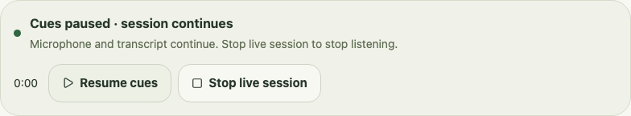

# Live cue pause

The notebook and companion offer **Pause cues** during a live session. It clears the current cue, including one held by opening its source, and suppresses suggestions while the microphone, transcription, and elapsed clock continue. **Resume cues** permits only newly spoken lines to raise cues. It does not replay suggestions from the pause. **Stop live session** remains available and stops listening through the existing Stop path.

This gives someone control over interruptions while continuing to follow the conversation. It does not establish that cues improve participation or listening; that remains part of the [comparison plan](research.md). Demo pause keeps its existing behavior: freezing scripted playback and preserving a held question.

## State and failure behavior

- Rust accepts cue-pause changes only for a running live session. An ended session cannot be resumed through this control, and a new session starts with cues enabled.
- Both windows receive `cuesPaused` in their snapshots. The frontend waits for native state; a rejected command leaves the existing controls and an actionable error.
- The notebook says that microphone and transcript continue. The compact companion shows **Cues off** and **Mic still on** when microphone state confirms it is listening. Starting, stopping, and microphone errors retain their own status text.
- Transcript lines still enter the bounded transcript and update which focus topics were mentioned. They do not raise questions, quotations, or note reminders while paused.
- Resume records the engine's current elapsed time. Delayed transcription at or before that time is kept in the transcript but cannot raise a cue. No paused suggestion is queued for later display.
- Stop, dismissal, source removal, and the ordinary one-cue/expiry policies remain Rust-owned. No capture permission, model call, persistence, export, or background inference is added.

## Headless acceptance, 10 November 2026

Three new Rust tests check clearing ordinary and held cues, continued clock/input/focus tracking, preservation of manual notes, suppression of different cue types, delayed transcription across resume, repeated commands, invalid sessions, Stop, and a fresh session. The combined library suite passed all 228 tests after incorporating the separate evaluator worker change.

The 74 Chromium/WebKit notebook and microphone tests passed. New cases exercise keyboard pause/resume, continued simulated microphone and transcript state, a rejected command and retry, Stop while paused, and control bounds at a 390-pixel notebook and 320 × 76 companion. Browser tests use mocked native events and fictional content; they do not test the native command transport or a real device. The frontend build, formatting, Rust Clippy checks, and macOS debug app bundle build also passed; the app was not launched.

These screenshots are headless fictional UI fixtures, not a recording or a real capture session. Before, the live controls only offered Stop:

After pausing, the notebook names what continues and offers Resume and Stop:

The compact companion retains its controls and visible microphone state:

Next acceptance: exercise pause/resume and Stop on a named Mac with synthetic speech, verify both windows update and the microphone releases on Stop, and check native keyboard/VoiceOver access and cross-app focus. Device changes and both-side capture remain separate open roadmap items. No hardware or user-outcome claim follows from these headless checks.
