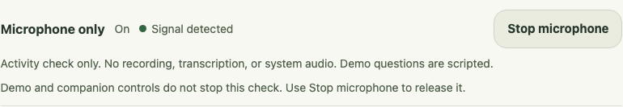
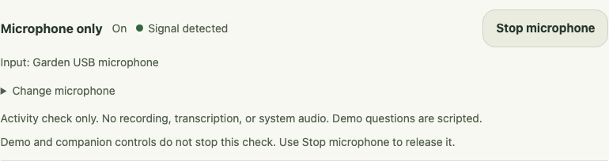
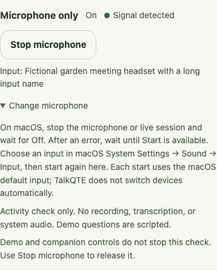

# Microphone input visibility

Development checkpoint, 11 November 2026. This responds to the owner's request to identify the microphone while checking capture. It supports an explicit, understandable input choice for the live companion; it does not establish useful cues or meeting comprehension.

## Smallest flow

After **Start microphone** or **Start live session**, the notebook and Settings show **Input: [name]** once the native stream has opened. The name belongs to that opened input, not a periodically refreshed macOS default or a list of connected devices. Permission pending has no invented device name. A missing/blank name does not prevent capture; a listening stream instead says **Input: name unavailable**.

**Change microphone** expands instructions beside status. Stop capture and wait for **Off** (or for Start to become available after an error), choose the desired input in macOS **System Settings → Sound → Input**, then explicitly start again. TalkQTE opens the default input on each start. There is no in-app device picker, enumeration, hot switching or automatic restart. Changing the system default during capture is not the supported switching flow.

**Stop** stays exposed outside the disclosure. While teardown is pending the name says **Releasing input**; Off or an error clears the label. The error still describes the capture problem, and retry remains unavailable until cleanup completes. A source label is not proof of signal, speech, connectivity after a disconnect, or release; status and signal activity remain separate.

## Native boundary and data

The existing macOS adapter reads the description of the same CPAL device used to build the stream, after explicit start and permission. A cached name travels through the existing revision-ordered microphone snapshot. There is no hardware query, event or allocation added to the audio callback. The controller strips control/direction-override characters and bounds the display name to 120 characters. It does not publish a late cancelled start's label.

The name is local, in-memory display metadata. It is not added to notes, transcripts, exports, logs or model/provider input. No device identifier or connected-device inventory is exposed. Both local webviews receive the snapshot; the notebook and Settings render the name. The companion retains its compact status/Stop controls. [Privacy behavior](../PRIVACY.md) and [capture architecture](architecture.md#microphone-activity-on-macos) describe the boundary.

## UI/UX checkpoint

The task is to identify the opened input and find the switching steps without obscuring Stop or adding another permanent setup panel. The experience risk is mistaking a connection label or stale name for an active source, or changing input before release.

| Before | After |
| --- | --- |
|  |  |

The before rendering uses the merged notebook implementation at `6c314db`; the after uses this change. Both are browser-rendered synthetic IPC, not hardware observations. The name is fictional. The owner’s desktop screenshot and device identity are not used.

Accepted for this bounded implementation: the green/cream palette and existing controls remain; a 390-pixel view wraps the long name and instructions with reachable Stop. Keyboard activation opens/closes the instructions without starting or stopping capture. Native VoiceOver, real device labels and owner usability acceptance remain pending.

## Acceptance evidence and remaining dependency

- Rust microphone checks cover named-stream release, permission/start failures, stalled/error cleanup, cancellation and bounded/unknown labels with fake streams. All 298 default-feature Rust tests pass locally; no real microphone is opened by these checks.
- All 58 targeted Chromium/WebKit checks pass locally and cover initial unknown state, pending permission, ordered device labels, stale updates after Stop, a different label on explicit restart, failure/cleanup, unknown and long names, keyboard disclosure, Settings during a live-session fixture and independent Stop. These mocks exercise the actual React controls, not Tauri IPC or macOS devices.
- Frontend build, formatting, contribution-metadata tests and Clippy with warnings denied pass. These do not establish native device behavior or a production release.

The next acceptance check is a rebuilt native app on a named Mac/OS and input route: compare the displayed name with the chosen input, confirm signal/quiet and release, select another default only after Stop, restart and observe the new label. Disconnect the external input and record the exact message, any fallback, cleanup and reconnect/restart behavior. Repeat the live-transcription path separately in a `local-whisper` build; the default-feature activity-monitor report below does not cover it. Check native keyboard/VoiceOver alongside the visible Stop control.

The [owner's earlier report](native-validation.md#owner-reported-microphone-acceptance--11-november-2026) applies to `4d647e7`, before this UI. No new capture or inference was performed for this change. Unavailable native desktop control prevents the follow-up here; it is not a confirmed TalkQTE defect. The broad capture, companion/Spaces/sharing, provider, signed-delivery and participation/listening gates remain open. Claude remains in the isolated lab.

## Disconnect logic review — 11 November 2026

The owner clarified that the earlier Bluetooth disconnect sequence was uncertain. Inspection at app `210fb5e` found the recovery paths already implemented; this follow-up strengthens tests and corrects the acceptance record without changing runtime behavior.

- The pinned CPAL 0.18.2 macOS [input implementation](https://github.com/RustAudio/cpal/blob/e1612d5d98152f8dc2a62e1b51ef7cbf4f7f26b7/src/host/coreaudio/macos/device.rs#L697-L817) binds the stream to the chosen device and installs a disconnect monitor. Input is not automatically rerouted. Its [device-loss listener](https://github.com/RustAudio/cpal/blob/e1612d5d98152f8dc2a62e1b51ef7cbf4f7f26b7/src/host/coreaudio/macos/mod.rs#L127-L242) attempts to pause and reports an error. These are source findings checked on 11 November, not observations of a Bluetooth device.
- TalkQTE's [native error callback](../src-tauri/src/microphone/native.rs) sets an atomic failure flag. The [controller](../src-tauri/src/microphone.rs) polls it on the app's nominal 200 ms timer and enters Error, clears signal/name, retires capture and releases the stream on a worker. Retry stays unavailable until teardown completes. This is not a measured hardware response-time guarantee.
- A separate watchdog follows callback arrival, not loudness. Three seconds without a valid nonempty sample block requests the same cleanup on a subsequent poll. Continuing silent samples remain Listening/Quiet. A stream that keeps supplying silent blocks without reporting a device error cannot be identified as disconnected by this watchdog alone.
- Error remains visible after cleanup. Reconnecting hardware alone does not start TalkQTE capture; an explicit Start opens the current macOS default again. Stale data/errors from the retired stream cannot reactivate it or affect the new stream. The live-session timer also notices a lost microphone generation and ends its owning session; live transcription/drain still needs separate native acceptance.

All 19 focused microphone tests pass with fake streams. The strengthened loss test begins with active audio, then checks immediate stream error separately from the three-second callback timeout, blocked retry during cleanup, label/activity clearing, late old callbacks, explicit retry and final Stop. A separate ten-second simulated silence check stays Listening. Existing slow-teardown and cancellation cases also pass. No real microphone, Bluetooth change or model inference was used.

The remaining acceptance is narrow: start with the external headset selected, confirm its label and Listening/signal, disconnect **while capture is active**, then record the exact status, any unexpected input fallback and release. Reconnect without pressing Start and confirm capture stays stopped; select the desired macOS input, explicitly restart, and confirm its label/signal. If capture continues on another input or stays Listening indefinitely after loss, record that as a failed native check rather than explaining it away with these fixtures. Native control is currently unavailable, so no result for that sequence is claimed here.
