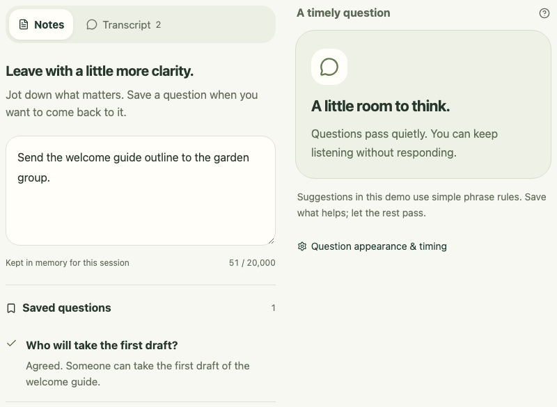
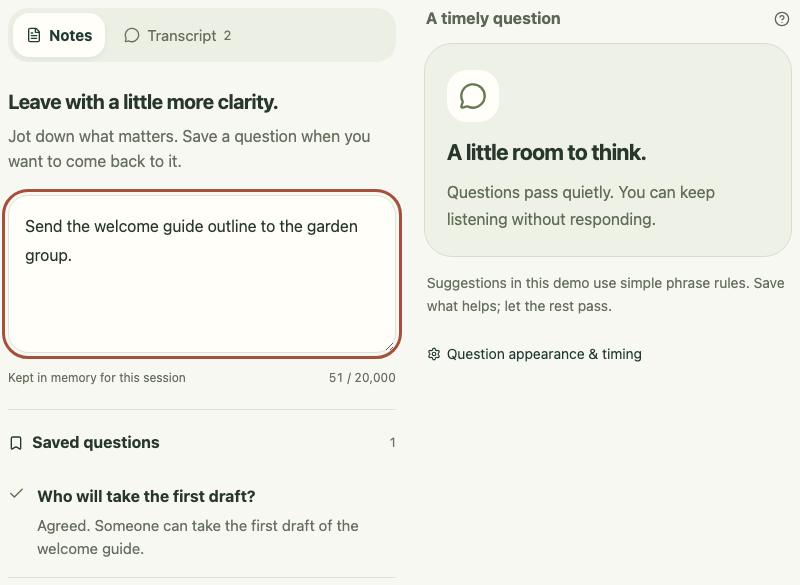

# Native companion validation

Baseline checked 8 November 2026 against source [`526d0cc`](https://github.com/connorburgess/talkqte/commit/526d0ccdcf00ac790a722ff76140c958d3a8b3a4), on macOS 26.4 (25E246), Apple silicon. This is a limited development smoke check, not a supported-platform, accessibility, or focus guarantee.

## Build and boundaries

The check used a new ad-hoc-signed debug app with a separate product name and bundle identifier. The only build overrides were `productName: "TalkQTE Native Validation"` and `identifier: "com.talkqte.native-validation"`; application code and window configuration matched the source above. The existing app and its notes were not used as test data.

Only the bundled fictional garden conversation and synthetic scratch text were used. The microphone stayed Off. No microphone, camera, screen-sharing, or other system permission was requested; no model or paid service was used. No desktop captures or local environment artifacts are included in this record.

Build a separate preview without modifying tracked configuration:

```sh
npm ci
validation_dir=$(mktemp -d -t talkqte-native-validation)
cat > "$validation_dir/config.json" <<'JSON'
{
  "productName": "TalkQTE Native Validation",
  "identifier": "com.talkqte.native-validation"
}
JSON
APPLE_SIGNING_IDENTITY=- CARGO_TARGET_DIR="$validation_dir/target" \
  npm run tauri -- build --debug --bundles app \
  --config "$validation_dir/config.json"
codesign --verify --deep --strict \
  "$validation_dir/target/debug/bundle/macos/TalkQTE Native Validation.app"
```

Ad-hoc signing is only a local development check. It is not Developer ID signing or notarization. Launch the separate preview deliberately; do not start microphone monitoring as part of window validation.

## Observed results

These are dated records. The Save question control they mention was removed later; questions are now dismissed or expire, and nothing is kept.

| Check                                                                  | Result and limit                                                                                                                                                                                                                                                                                                                                                                             |
| ---------------------------------------------------------------------- | -------------------------------------------------------------------------------------------------------------------------------------------------------------------------------------------------------------------------------------------------------------------------------------------------------------------------------------------------------------------------------------------- |
| Frontend and native bundle build; strict bundle signature verification | Passed for the source above.                                                                                                                                                                                                                                                                                                                                                                 |
| Rust tests                                                             | All 30 passed, including placement bounds at scaled/negative display origins, small work areas, context expansion anchors, held-question lifecycle, and microphone tests with fake streams. These do not observe a real display or microphone.                                                                                                                                               |
| Notes focus during timed question arrival                              | The native accessibility observation reported the same Meeting notes field focused before playback and again with the first question present at approximately 0:15. The cue is scheduled at 0:05; this observation did not measure its arrival latency. This checks focus within the notebook, not the active application across the desktop.                                                |
| Keyboard disclosure and save                                           | From Meeting notes, Tab reached Why?/Hide context. Return opened and collapsed the source, keeping focus on the disclosure. Tab reached Save question; Return saved the held question and exact fictional source while playback was paused. After Save removed the card, the accessibility observation reported document focus; a deliberate post-action focus destination was not verified. |
| Appearance controls through native IPC                                 | Settings accepted bottom-right, top-center, top-left, and top-right choices and larger text. The held question survived returning to the notebook. This confirms settings and notebook state, not the companion's physical position, size, or visibility.                                                                                                                                    |

The observation tool returned the notebook window even after selecting the nonfocusable companion in the native Window menu. Its app-specific focus result also does not identify the desktop's active application. Those observations cannot prove companion placement or cross-app focus. A scratch-editor attempt therefore remains inconclusive.

No native adapter defect was reproduced in this pass. The notebook focus issue found here was fixed as described below. Neither result establishes that the pending cases pass.

## Keyboard focus follow-up

The same isolated build procedure was repeated with application code at [`38cb37d`](https://github.com/connorburgess/talkqte/commit/38cb37dd56ecfbf5cc50e47d44a475850fd77b49), based on main after the prompt-motion change. The debug bundle and strict signature check passed; the microphone remained Off.

In the rebuilt native app, Tab from Meeting notes reached the source disclosure. Return collapsed the source while retaining disclosure focus. Tab then reached Save question, and Return saved the paused question and returned focus to Meeting notes. On a separate demo replay, keyboard Dismiss also removed the paused question and returned focus to Meeting notes. This verifies the notebook regression on this Mac; it does not verify another app retaining focus.

Browser regressions cover keyboard Save and Dismiss, retaining source-disclosure focus when collapsing, returning a transcript reader to the selected Transcript tab, and leaving focus untouched for timed expiry or a response from another window. A mocked-IPC test delays the Save acknowledgement after the shared snapshot removes the question: moving to Search meetings during that delay must keep search focused when the acknowledgement arrives. The browser tests begin from an explicitly focused control rather than changing the browser or operating system's button-tabbing preference.

### Browser focus appearance

These matching Chromium renders use the bundled fictional demo and identical synthetic notes after keyboard Save. Before is source [`37197f3`](https://github.com/connorburgess/talkqte/commit/37197f31c5e9a58de3bba7c77ca92353d787d7e8); after is [`9724e7e`](https://github.com/connorburgess/talkqte/commit/9724e7e034a745e27e8893032eb97f19d213fa13). The capture check confirmed document focus before and Meeting notes focus after. These images show browser focus styling only; the separate native observations are described above.

| Before: editor loses focus after Save                                                           | After: focus returns to Meeting notes                                                                             |
| ----------------------------------------------------------------------------------------------- | ----------------------------------------------------------------------------------------------------------------- |
|  |  |

## Remaining manual acceptance checks

All **seven groups below remain pending**. Use a fresh isolated preview, fictional content, and a known build commit. Record the OS, display arrangement and scale, app used for the check, exact steps, expected result, and observed result. Keep private desktop evidence outside the repository. A screenshot cropped to the app can show appearance but cannot prove its position on a display or which application has focus.

| Pending group                                             | Procedure and acceptance criteria                                                                                                                                                                                                                                                                                                                                                                                                                                                                                                                                                                                                                                                                                                                                                                                                                                                                                                                                                                                                                                                                                                                                                                      |
| --------------------------------------------------------- | ------------------------------------------------------------------------------------------------------------------------------------------------------------------------------------------------------------------------------------------------------------------------------------------------------------------------------------------------------------------------------------------------------------------------------------------------------------------------------------------------------------------------------------------------------------------------------------------------------------------------------------------------------------------------------------------------------------------------------------------------------------------------------------------------------------------------------------------------------------------------------------------------------------------------------------------------------------------------------------------------------------------------------------------------------------------------------------------------------------------------------------------------------------------------------------------------------ |
| Native placement and sizing                               | At each of the four presets, observe compact, question, and expanded-context states with standard and larger text. Check all controls and text remain reachable inside the display work area. Bottom-right expansion must preserve the bottom/right anchor; top presets must preserve their top anchor. Collapse context and confirm the question remains held.                                                                                                                                                                                                                                                                                                                                                                                                                                                                                                                                                                                                                                                                                                                                                                                                                                        |
| Cross-app focus and companion controls                    | Use a new synthetic scratch document in a separate app. Start the demo, activate that document, and observe the active app and caret across question arrival, expiry, and companion resize. Continue typing without explicitly targeting or reactivating the editor. Then click Why?, Dismiss, Pause/Resume, and Hide on the companion and check where subsequent keys go. No implicit focus transfer is acceptable. Verify Hide can be reversed from Settings and does not change demo or microphone state.                                                                                                                                                                                                                                                                                                                                                                                                                                                                                                                                                                                                                                                                                           |
| Display and work-area changes                             | Move the notebook between real displays with different scales and origins. Check the companion follows its display without clipping or jumping onto an unrelated display. Test a display disconnect and Dock/work-area changes, then confirm controls remain reachable. Unit-tested geometry is not a substitute for these native events.                                                                                                                                                                                                                                                                                                                                                                                                                                                                                                                                                                                                                                                                                                                                                                                                                                                              |
| Spaces and full-screen apps                               | Use only an isolated synthetic app or blank test window. Check switching Spaces, entering/exiting full screen, returning to the notebook, and hiding/showing the companion. Record actual visibility and focus; do not promise presence on every Space until observed. Avoid changing another person's existing workspace or full-screen state.                                                                                                                                                                                                                                                                                                                                                                                                                                                                                                                                                                                                                                                                                                                                                                                                                                                        |
| Native accessibility and keyboard completion              | With explicit permission to change assistive settings, check VoiceOver reading order, question announcements, Why?/source relationship, Dismiss, and returning to notes. Test focus after an action removes the question, larger text, and the user's normal keyboard settings. Browser live-region assertions and this notebook smoke check do not establish VoiceOver behavior or accessibility conformance.                                                                                                                                                                                                                                                                                                                                                                                                                                                                                                                                                                                                                                                                                                                                                                                         |
| Screen sharing                                            | In a separately authorized synthetic sharing session, inspect the receiving side for each supported sharing mode: whole display, individual window, and app where available. Document whether the companion is visible and whether Hide removes it. Treat it as potentially visible until verified; do not describe it as hidden from sharing.                                                                                                                                                                                                                                                                                                                                                                                                                                                                                                                                                                                                                                                                                                                                                                                                                                                         |
| Live session controls and companion changes of 9 November | From a `local-whisper` development build of `main` at or after the drag change (#79): start a live session, say a line with a vague deadline, then **Stop live session** and confirm the macOS microphone indicator goes away and the last line still arrives; start again and confirm the clock restarts from 0:00 and the next question appears in the companion (the restart fix, #78). Drag the companion by its top bar while a meeting app is in front and confirm it moves on the first click, keeps its place when a question opens and when **Why?** grows it, and returns when a preset or **Move back here** is chosen in Settings. Set a focus line in Settings and say a line using two of its words during the pause after a dismissed question; the companion should label the question “about what matters”. Switch the companion to Focused and confirm an off-focus “someone can…” line raises nothing, then say “before we finish, anything else?” and confirm the untouched focus lines are listed once. Deny the microphone once in System Settings and confirm the session ends with a message rather than hanging; change the input device mid-session and record what happens. |

## Microphone activity check

On 8 November 2026 the owner ran a short check with the owner's explicit permission. It used a separately named, ad-hoc-signed debug bundle ("TalkQTE Mic Check", identifier `com.talkqte.miccheck`) built from [`33260ba`](https://github.com/connorburgess/talkqte/commit/33260baf2172f11f2e34b7cc7a5a6f311db6c7b4) (`main` plus the worker-count fix in #30), on an Apple M5 Pro with macOS 26.4 and the default input device. The bundle carried the `com.apple.security.device.audio-input` entitlement and the usage text "Show microphone activity when you choose to start monitoring. Audio is not saved or sent anywhere." The fictional demo was not involved, and nothing was recorded, kept, transcribed, or sent.

| Check            | Result                                                                                                                  |
| ---------------- | ----------------------------------------------------------------------------------------------------------------------- |
| Permission       | macOS asked for microphone access only after **Start microphone** was chosen; the owner allowed it.                     |
| Signal activity  | Speaking showed **Signal detected** in the app.                                                                         |
| Stop and release | After **Stop microphone**, the app showed the microphone as off, and the macOS menu-bar microphone indicator went away. |
| App exit         | The test app quit cleanly with no leftover process.                                                                     |

These are the owner's observations, reported to the developer; no screen capture was taken. The owner noted the controls work but the interface needs polish. Not checked: permission denial, device disconnect or change, headphones or Bluetooth, other Macs or macOS versions, and long sessions. Microphone activity is still not connected to transcription or cues.

## Live session check

On 9 November 2026 the owner ran the first live session on hardware, with the owner's explicit permission, from a `local-whisper` development build (`npm run tauri -- dev --features local-whisper`) of `main` at [`2faa84a`](https://github.com/connorburgess/talkqte/commit/2faa84a0783ffef1d780a48d1069bf44c6ce322d)'s parent, on an Apple M5 Pro Max with macOS 26.4, the built-in microphone, and the `tiny.en` model installed from Settings (78 MB). Two Parallels virtual machines were running at the time, with the Mac's memory at about 85%. Three fictional notes, written for the check, were imported from a file on the owner's desktop. Nothing was recorded, kept, exported, or sent; the owner quit the app afterwards.

| Check                   | Result                                                                                                                                                                                           |
| ----------------------- | ------------------------------------------------------------------------------------------------------------------------------------------------------------------------------------------------ |
| Start                   | **Start live session** asked for microphone access, the session showed **On**, and the companion showed "Listening · On this device" with Stop and Hide.                                         |
| Transcription           | Lines appeared in the Transcript tab as the owner spoke (2 lines at 0:13, 5 at 0:46). A greeting alone raised no question, as intended.                                                          |
| Vague-deadline question | "Someone should look at compost bins soon" raised **What date should we aim for?** (Timing), in the notebook and the companion, with **Why?** and **Dismiss**.                                   |
| Context reminder        | A line using the words of the imported note "Volunteer schedule for the garden" raised the reminder in the companion, labelled "Reminder from your notes · 2026-11-02" and kept until dismissed. |
| Missing-owner question  | Not raised by that line: the owner rule matches "someone can…", not "someone should…". Recorded as a rule gap, not a transcription fault.                                                        |

These are the owner's observations with screenshots of the owner's own screen, which are not committed. Not measured: the delay from speech to line, transcription accuracy against what was said, and processor or memory use. Not checked: a question asked of the owner by name, an open question, Stop releasing the microphone, permission denial, device disconnect or change, headphones or Bluetooth, and the floating window's focus behaviour over a meeting app.

The owner's interface notes from the check, for the companion: **Why?** opens its context downward and pushes the controls away; **Dismiss** and **Hide context** are heavier than a glance window should carry and could be icons or lighter text.

Real-device capture of both sides of a call and disconnect checks remain separate work. None is required to run the fictional window checks. See the [architecture](architecture.md) and [Glance design limits](glance-mode.md).
