# Quieter notebook

11 November 2026. The task is to reach the current conversation, optional notes and cue controls without a wall of setup instructions. Keep TalkQTE’s evergreen navigation, warm paper palette and current functionality.

The meeting list now uses compact rows (the list and its search were removed on 14 November 2026: nothing is kept between launches, so the list only ever held the current session; **Not now** in setup now returns focus to **Notebook** in the sidebar). Since 24 November 2026 a **Meetings** page in the sidebar lists the meetings a person chose to keep, with its own search; the sidebar still lists none ([kept meetings](meeting-history.md)). The note editor sits directly on the paper surface, with understated Notes/Transcript tabs. Repeated introductory headings, decorative avatars and idle-card examples are removed. No real meeting or reference screenshot is reproduced.

**Set up a live session** in the sidebar opens the existing first-run checklist. **This meeting** below the editor and cue area opens the optional Focus field, its explanation and Granola suggestions when connected. Both begin collapsed. Setup’s focus shortcut opens the section before focusing the field. Closing it preserves the draft; the expanded state survives Settings navigation for this mounted notebook. A rejected Focus save or suggestion request reveals its error without moving keyboard focus, including on return when the failure arrives while Settings is open. Waiting/ready suggestion states are named in the collapsed summary. These are session-only interface choices.

Microphone status, Stop/Cancel, errors, demo controls and cue actions remain exposed. Prior context, Granola connection/disconnect, selected-note removal, export review and resize dividers remain available. Collapsing Focus neither cancels a pending request nor disconnects an integration. No capture, inference, permissions or retention behavior is added.

## UI/UX checkpoint

| Before: setup and cards dominate the opening view                                        | After: the editor and cue area are visible                                             |
| ---------------------------------------------------------------------------------------- | -------------------------------------------------------------------------------------- |
| 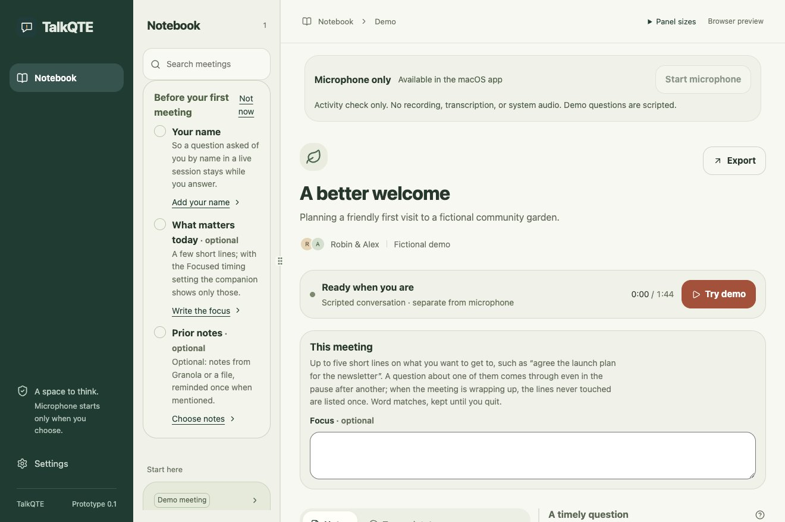 | 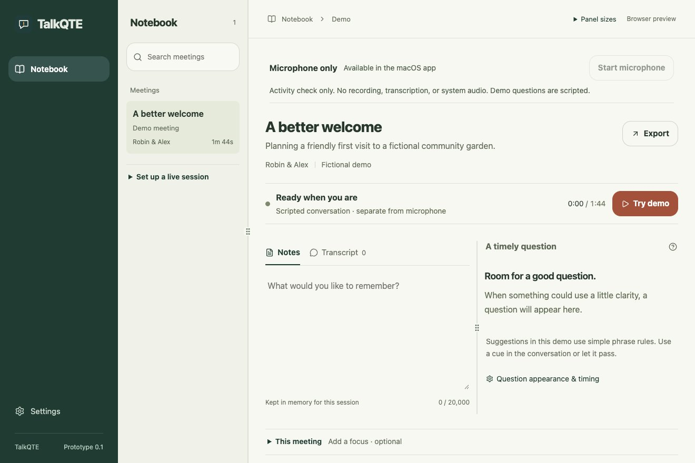 |

These are browser renders at 1320 × 880. The [320-pixel expanded-setup view](assets/notebook-quiet-narrow.png) shows the retained controls and the keyboard focus ring after cancelling a file import. Narrow screens continue to stack the cue area above the editor. Browser renders and fixtures do not establish native webview, VoiceOver or meeting usefulness.

Experience risk: hiding optional setup could make it harder to find, and a collapsed field could conceal failures. Acceptance checks cover opening by keyboard, the setup shortcut, retaining notes and Focus while collapsing/reopening, dismissal focus, import cancellation and reopening rejected saves without focus theft. The existing suites also cover resize bounds, source controls, pending capture, delayed saves, disconnected providers and cue dismissal.

Moving Focus exposed a blur edge case: when the field is empty and the Clear button is absent, tabbing out can have no next DOM focus target. That departure now saves the empty value instead of mistaking it for activation of Clear. Existing ordered-save tests cover clearing during a pending save and superseding an accepted suggestion with the empty draft in both browsers.

Local validation: all 328 browser checks passed across Chromium and WebKit before the final navigation-recovery correction. The frontend build and 70 targeted notebook/Focus checks passed again after that correction; formatting and diff checks pass. The browser suite uses fictional data and mocked native events; it does not exercise the hardware microphone or native windows. The PR records required checks on its final commit.

Acceptance: the bounded browser flow is ready for native/user review. Next dependency: an owner walkthrough in the native app covering first-run discoverability, writing a note, adding/removing prior context, resizing, keyboard/VoiceOver and visible Stop. Compare the simpler layout during a fictional conversation before claiming reduced distraction or improved participation. Capture reliability, cross-app focus, Spaces, full-screen/sharing, integration recovery, signed delivery and user-outcome studies retain their separate release gates.

## Combined navigation and context check — 13 November 2026

At 600 × 700, a fictional browser fixture exercises the compact navigation with selected prior context and a simulated live session together. It checks the selected note's title, date, provider and ID; opens a simulated cue's conversation source; keeps Stop enabled during a held listing and operates it by keyboard after scrolling into view; retries a failed disconnect; and removes the retained note after the late listing settles. It also checks the neighboring tab route to Disconnect, Settings and return to Notebook, and document-level horizontal fit. The cue source in this test is conversation evidence, not a claim that the cue cites the imported note.

Chromium and WebKit pass this combined check against mocked IPC. Together with the existing keyboard, narrow-layout, capture-control and context suites, it completes the bounded browser layout item. It does not establish continuous on-screen Stop visibility, complete tab traversal, actual device release, native VoiceOver, real-account recovery or user comprehension. Those remain separate acceptance checks.

## The notebook's own session states — 14 November 2026

The notebook used to open as a fictional demo meeting, with its title, speakers, clock and **Try demo**. At the owner's decision the in-app demo was removed, and the notebook now has a state of its own before a session, during one and after Stop.

| Before a session (ordinary build)                                                                            | During a live session                                                                        | After Stop                                                                                         |
| ------------------------------------------------------------------------------------------------------------ | -------------------------------------------------------------------------------------------- | -------------------------------------------------------------------------------------------------- |
| 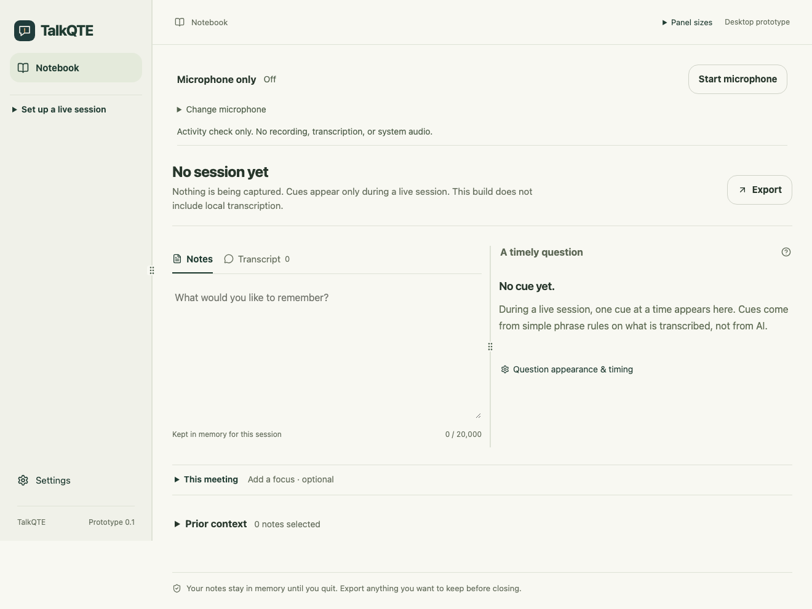 | 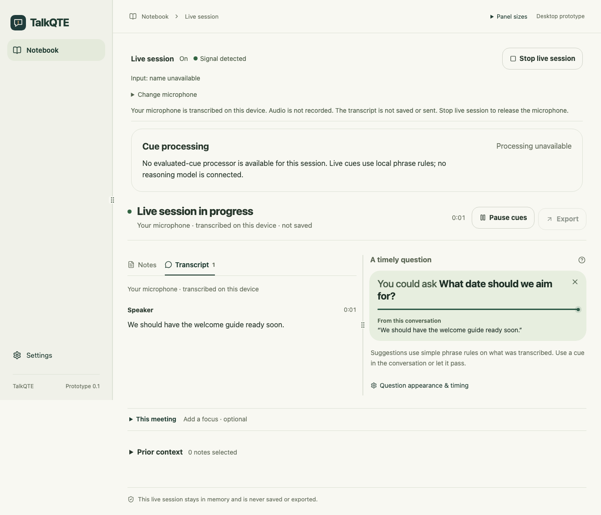 | 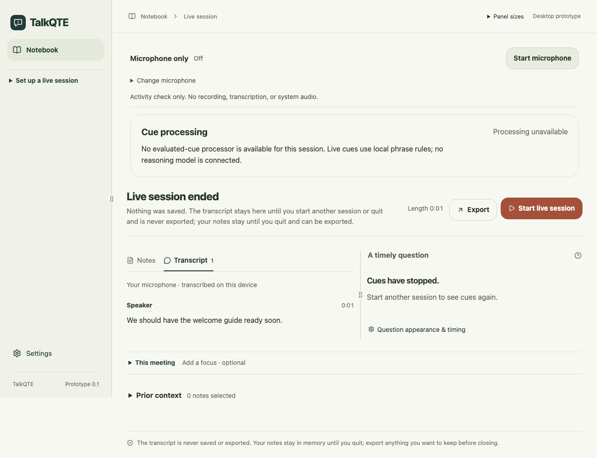 |

- **Before:** the heading reads **No session yet**, followed by "Nothing is being captured." (or, while the microphone check is on or a selected application's audio may still be captured, a sentence saying so instead) and what applies to this build: **Start live session** when the build and launch can run one, or a plain statement that cues appear only during a live session followed by the reason, such as "Add your Anthropic API key in Settings to start a live session." or "Add your Deepgram API key in Settings to start a live session." (the browser preview says "This build has no live transcription.") (Until 16 November 2026 a build missing its speech model offered **Set up live session** instead; on-device transcription has since been removed, and the screenshot predates that.) There is no clock, no status dot and no sample content.
- **During:** the heading reads **Live session in progress** with where the audio comes from, the elapsed time and **Pause cues**. Stop stays in the microphone panel above, as before.
- **After Stop:** the heading reads **Live session ended**, with "Nothing was saved." and how long the transcript and the notes remain (the transcript until another session starts, the notes until quit). **Start live session** is offered again. Export is available again and holds the notes only, unless the person ticks **Also keep this meeting** in the export review, which adds that session's transcript and the cues shown; the choice is off for every new session. Below the session heading, **Meeting notes** offers **Write meeting notes…** once per meeting ([meeting notes](meeting-notes.md)).

These renderings come from the browser tests' fictional native stand-in, with fictional lines; no microphone or transcription was involved. Chromium and WebKit checks (`tests/notebook-session.spec.ts`) cover the three states, the wording for each kind of build, the absence of the words "demo" and "fictional" before a session and in Settings, and control sizes at 320, 390 and 880 pixels with reduced motion. Not checked: the desktop app, an actual microphone session, VoiceOver, and whether a person finds the empty state clear.

Until 14 November 2026 Export stayed unavailable for the rest of a launch once a live session had run, so notes written beside a live session could not be exported. At the owner's decision the notes can now be exported once the session has ended. The export is the notes and nothing else, and it is still refused while a session runs.

## Product pass — 23 November 2026

A typography, layout and wording pass brings the notebook closer to a calm workspace beside a meeting without changing its palette, controls, states or consent order.

What changed:

- **Typography, spacing and sidebar:** the session title, Settings title and section headings use the house serif (`Georgia, 'Times New Roman', serif`) while body text, controls, labels and the cue card stay in rounded sans. A shared spacing scale (4–48 px) and aligned margins replace ad-hoc gaps, and the sidebar surface now runs the full height of the window when the workspace scrolls.
- **Toolbar and sidebar labels:** the desktop toolbar no longer shows "Desktop prototype" (the browser preview keeps "Browser preview"); the sidebar footer reads `TalkQTE` · `0.1 · early development` (`0.1 · alpha` since the own-key alpha).
- **Microphone check and live capture bar:** the idle microphone check reads **Microphone check** in one quiet row with plain wording ("Shows whether your microphone picks up sound…") and no enclosing rule; when on, stopping or in error it keeps full prominence. During a live session, the capture bar shows status and Stop on one line, Input and Change microphone below it, and the unchanged data paragraph in 14 px.
- **Session strip and cue area:** the session title H1 is the anchor of the window; during a live session its subline drops the repeated transcription phrase (which stays word for word in the capture bar above and in the Transcript tab). The cue column is titled **Cues** without the decorative help icon, updates its idle line to "In this version cues come from simple phrase rules, not AI.", and links to **Cue appearance and timing**. Settings renames its data section heading to **Your data**.
- **Cue processing:** the panel drops its enclosing card border and radius in favor of hairline rules and spacing. Explicit `Step 1 of 2` and `Step 2 of 2` markers sit above `Choose what to process` and `Review before enabling`, and the review definition list uses hairline rows (stacking to one column when narrow). Development-only items (the `Application audio` launcher, `Lab run details` inside a `
` disclosure, and the `approvalBySetting` notice) are grouped at the end of the panel under a muted `Development build` heading above a dashed hairline, shown only when a snapshot reports a lab processor, `approvalBySetting` or an application source; the application-audio status line and **Stop application audio** stay at the top of the panel.

What did not change:

- Colours (light paper/evergreen/terracotta palette unchanged; no dark scheme), control behaviour, three-step per-session approval, consent/safety/status wording, the cue card (`Question.tsx`), the floating companion window, and Rust backend behaviour. Ordinary builds still have no live transcription and no model connection.

| Before a session, ordinary build: before                                                                         | After                                                                                                          |
| ---------------------------------------------------------------------------------------------------------------- | -------------------------------------------------------------------------------------------------------------- |
| 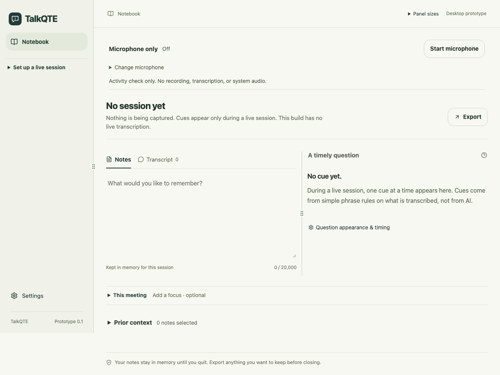 | 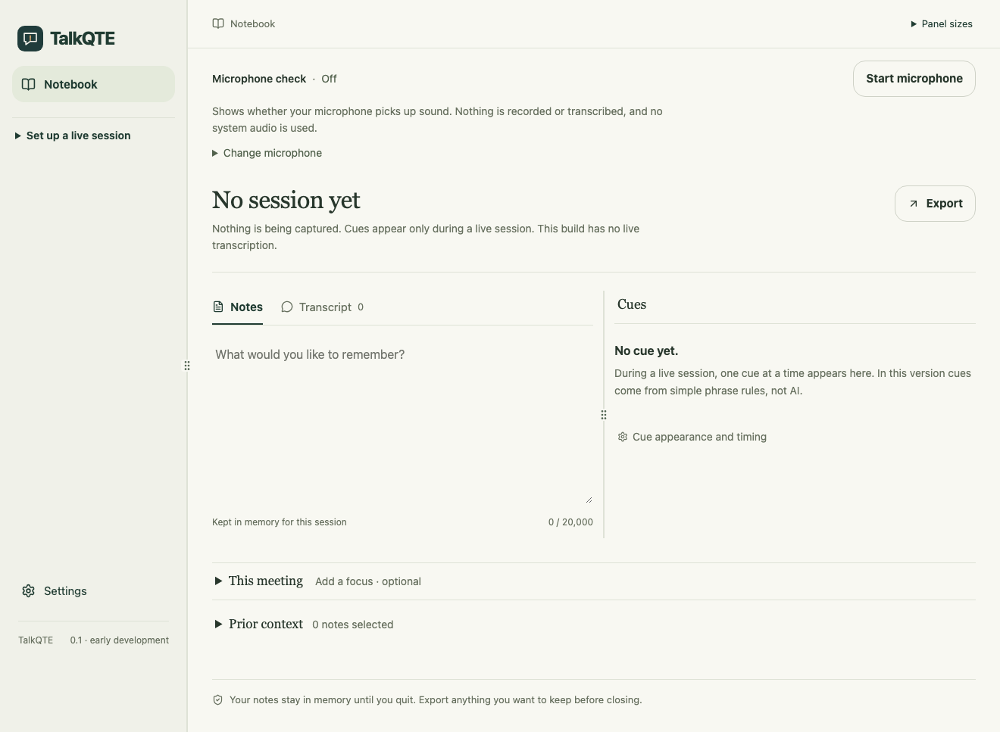 |
| **Live session in a development build, cue processing not yet approved: before**                                 | **After**                                                                                                      |
| 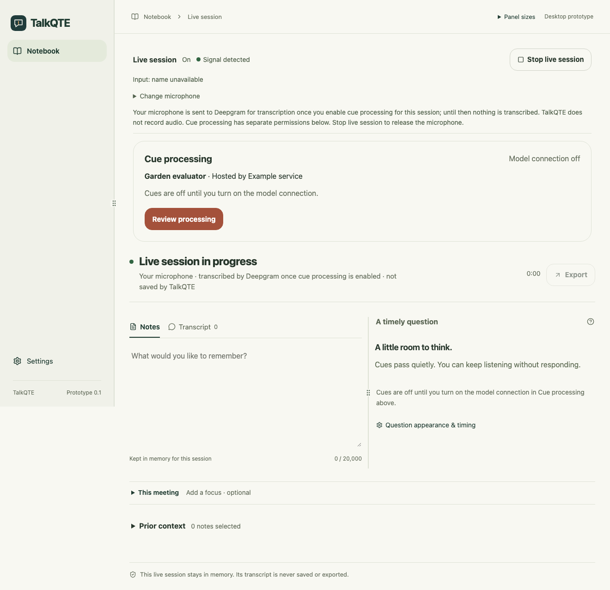          | 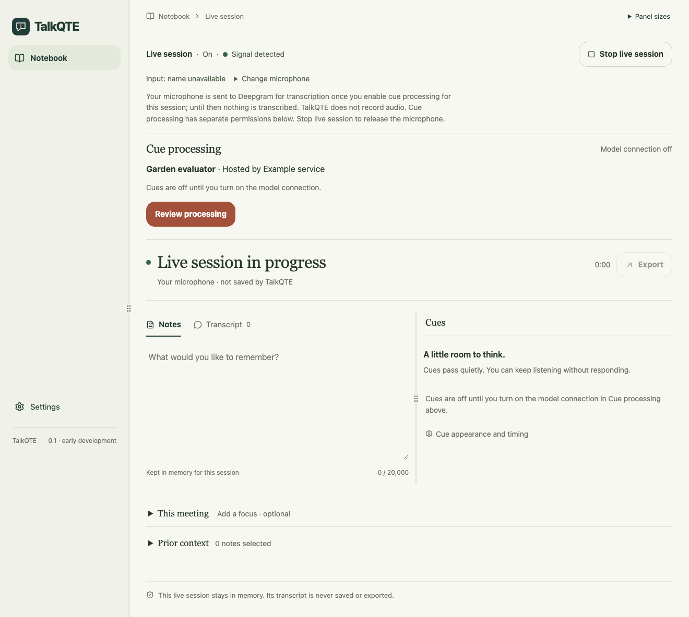          |

The [second approval step](assets/notebook-product-after-review.png) keeps its full data statement under the new `Step 2 of 2` marker. These are browser renders at 1320 × 880 with reduced motion, from the browser tests' fictional native stand-in with a fictional hosted processor; no microphone, transcription or provider was involved.

Checked headlessly: the full browser suite in Chromium and WebKit; no horizontal overflow and no console errors at 1320 × 880 and 390 × 844 in twelve states (browser preview, ordinary build before a session and with the microphone check on, development build before, during and after a live session, each approval step, approved, and Settings with the application-audio host); the keyboard order through the notebook during an open approval is the same as before apart from the renamed **Cue appearance and timing**, with a visible focus ring on every stop; no overflow at 200% zoom or with root text at 200%; no animation or transition with reduced motion. In a development build that shows both a model processor and an idle application source, the application-audio controls now come after the approval controls in the panel and in keyboard order. Not checked: the desktop app, VoiceOver, and whether a person finds the window clearer.

### Brand Direction C (White and studio amber) — 23 November 2026

Following the owner's brand selection, the app adopted Direction C on a white base (`#ffffff` work areas, `#f3f5f7` drafting vellum sidebar, `#11151b` carbon ink and primary actions, `#875500` amber ink for light-surface accents and focus rings, `#ebb45b` solar amber reserved for dark companion surfaces and the mark, and `#0d1014` void carbon for the floating companion dock). Self-hosted `Manrope Variable` and `IBM Plex Mono` fonts (SIL OFL 1.1 under `public/fonts/` and `LICENSES/`, recorded in `LICENSING.md` and `src-tauri/THIRD-PARTY-NOTICES.txt`) replaced system sans and the earlier Georgia serif headings while preserving all glance cue sizes and motion timings in `DESIGN.md`. `public/mark.svg` now uses the Direction C Calibrated Cue mark. The **Asked you** cue replaced its one-sided left edge (`.cue-edge`) with a quiet warm tint (`#fdf6e9`) and a full 1.5 px border all round in amber ink (kept in `CanvasText` under forced colours), active Notes/Transcript tabs use `text-decoration: underline` instead of a bottom border, and `scripts/check-one-sided-borders.mjs` runs in CI allowing only reviewed 1 px neutral structural hairlines. Both the floating dock (pure white default cue card, `18px` shell / `13px` card corners, uppercase mono cue labels with square marker, bold Manrope state titles) and the desktop notebook working panels (sidebar, toolbar and Panel sizes popover, microphone check, session strip, Cue processing steps and review table, Notes/Transcript rows, Cues pane, disclosures, Settings, and export dialog) align to Section 8 of the brand guide without changing wording, control names, DOM/keyboard order, or lab contracts.

### First-run onboarding and provider keys — 23 November 2026

The four-step onboarding flow (`src/components/Onboarding.tsx`) shares the single provider-keys surface (`src/components/ProviderKeys.tsx`, `src/lib/providerKeys.ts`) with **Settings → Your API keys** in Direction C, alongside Direction C styling for the export dialog's kept-meeting controls (`src/components/KeepMeetingChoice.tsx`). Builds without the Rust key commands never open onboarding automatically. See [First-run onboarding and provider keys](onboarding.md).

| Before a session, ordinary build                                                  | Live session, development build, Cue processing not yet approved                               |
| --------------------------------------------------------------------------------- | ---------------------------------------------------------------------------------------------- |
| 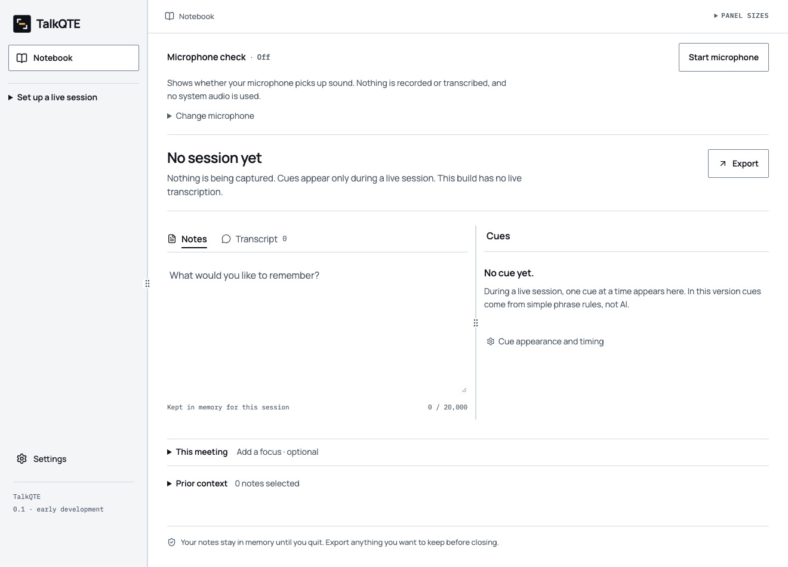 | 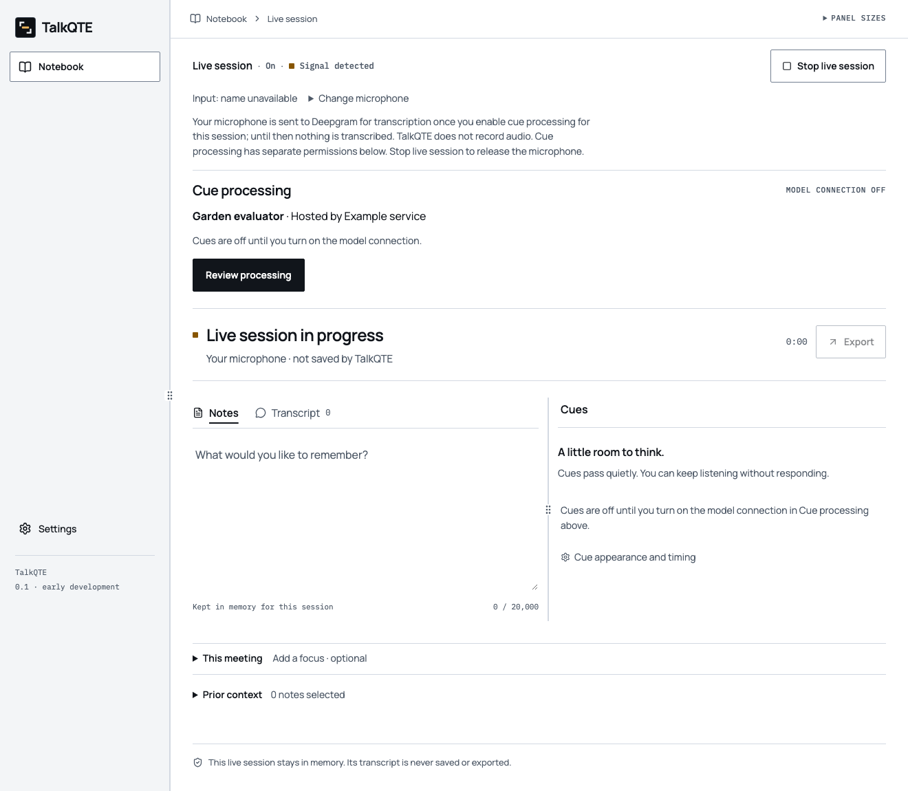 |

The [second approval step](assets/notebook-brand-c-review.png) and the [Development build group](assets/notebook-brand-c-development.png) are rendered in direction C too. The floating companion, before (first row) and after (second row), with the bar alone and with a suggested question, a Said quote, an Asked you question and a held question: 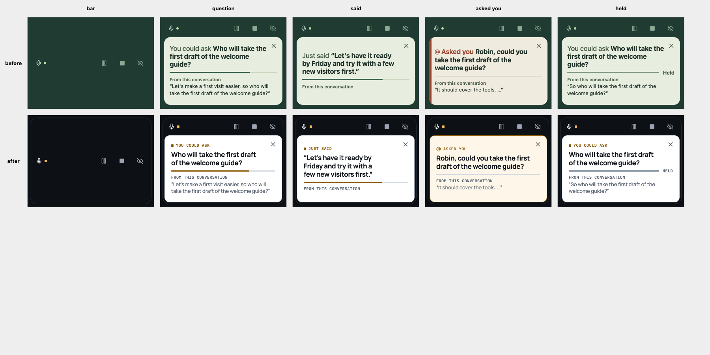

Checked headlessly on the final commit: the full browser suite in Chromium and WebKit; no overflow and no console errors in the same twelve notebook states at 1320 × 880 and 390 × 844; the same keyboard order as before with a visible focus ring at every stop; no overflow at 200%; no animation or transition with reduced motion. Measured on screen, the lowest text contrast is 5.77:1 in the notebook and 4.94:1 in the companion, and every focus ring is at least 5.77:1 against its background. Renders use the tests' fictional stand-in; the desktop app and VoiceOver were not checked.
