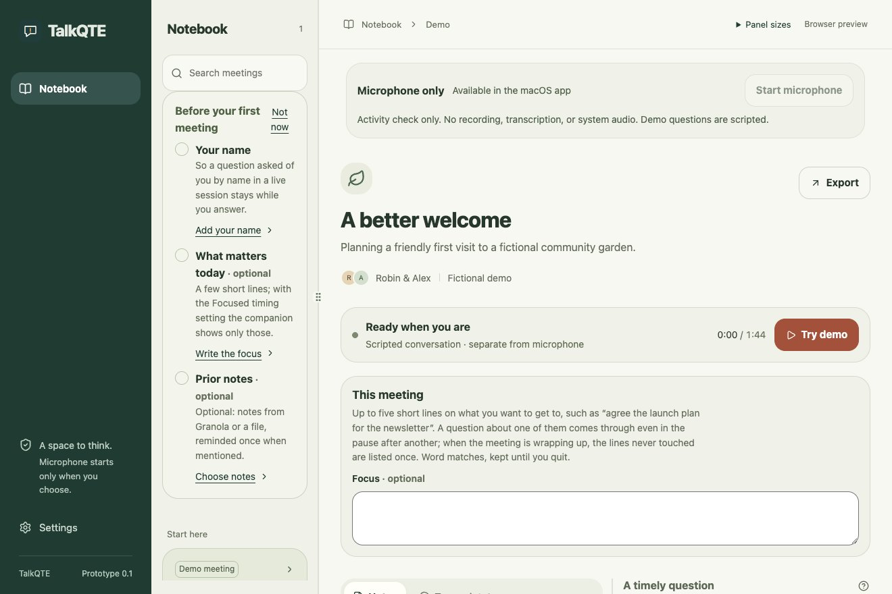
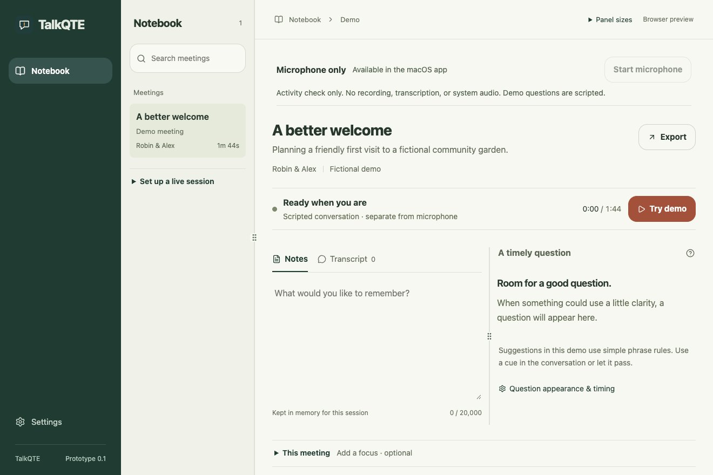

# Quieter notebook

11 November 2026. The task is to reach the current conversation, optional notes and cue controls without a wall of setup instructions. Keep TalkQTE’s evergreen navigation, warm paper palette and current functionality.

The meeting list now uses compact rows. The note editor sits directly on the paper surface, with understated Notes/Transcript tabs. Repeated introductory headings, decorative avatars and idle-card examples are removed. No real meeting or reference screenshot is reproduced.

**Set up a live session** below the meeting list opens the existing first-run checklist. **This meeting** below the editor and cue area opens the optional Focus field, its explanation and Granola suggestions when connected. Both begin collapsed. Setup’s focus shortcut opens the section before focusing the field. Closing it preserves the draft; the expanded state survives Settings navigation for this mounted notebook. A rejected Focus save or suggestion request reveals its error without moving keyboard focus, including on return when the failure arrives while Settings is open. Waiting/ready suggestion states are named in the collapsed summary. These are session-only interface choices.

Microphone status, Stop/Cancel, errors, demo controls and cue actions remain exposed. Prior context, Granola connection/disconnect, selected-note removal, export review and resize dividers remain available. Collapsing Focus neither cancels a pending request nor disconnects an integration. No capture, inference, permissions or retention behavior is added.

## UI/UX checkpoint

| Before: setup and cards dominate the opening view                                        | After: the editor and cue area are visible                                             |
| ---------------------------------------------------------------------------------------- | -------------------------------------------------------------------------------------- |
|  |  |

These are browser renders at 1320 × 880. The [320-pixel expanded-setup view](assets/notebook-quiet-narrow.png) shows the retained controls and the keyboard focus ring after cancelling a file import. Narrow screens continue to stack the cue area above the editor. Browser renders and fixtures do not establish native webview, VoiceOver or meeting usefulness.

Experience risk: hiding optional setup could make it harder to find, and a collapsed field could conceal failures. Acceptance checks cover opening by keyboard, the setup shortcut, retaining notes and Focus while collapsing/reopening, dismissal focus, import cancellation and reopening rejected saves without focus theft. The existing suites also cover resize bounds, source controls, pending capture, delayed saves, disconnected providers and cue dismissal.

Moving Focus exposed a blur edge case: when the field is empty and the Clear button is absent, tabbing out can have no next DOM focus target. That departure now saves the empty value instead of mistaking it for activation of Clear. Existing ordered-save tests cover clearing during a pending save and superseding an accepted suggestion with the empty draft in both browsers.

Local validation: all 328 browser checks passed across Chromium and WebKit before the final navigation-recovery correction. The frontend build and 70 targeted notebook/Focus checks passed again after that correction; formatting and diff checks pass. The browser suite uses fictional data and mocked native events; it does not exercise the hardware microphone or native windows. The PR records required checks on its final commit.

Acceptance: the bounded browser flow is ready for native/user review. Next dependency: an owner walkthrough in the native app covering first-run discoverability, writing a note, adding/removing prior context, resizing, keyboard/VoiceOver and visible Stop. Compare the simpler layout during a fictional conversation before claiming reduced distraction or improved participation. Capture reliability, cross-app focus, Spaces, full-screen/sharing, integration recovery, signed delivery and user-outcome studies retain their separate release gates.

## Combined navigation and context check — 13 November 2026

At 600 × 700, a fictional browser fixture exercises the compact navigation with selected prior context and a simulated live session together. It checks the selected note's title, date, provider and ID; opens a simulated cue's conversation source; keeps Stop enabled during a held listing and operates it by keyboard after scrolling into view; retries a failed disconnect; and removes the retained note after the late listing settles. It also checks the neighboring tab route to Disconnect, Settings and return to Notebook, and document-level horizontal fit. The cue source in this test is conversation evidence, not a claim that the cue cites the imported note.

Chromium and WebKit pass this combined check against mocked IPC. Together with the existing keyboard, narrow-layout, capture-control and context suites, it completes the bounded browser layout item. It does not establish continuous on-screen Stop visibility, complete tab traversal, actual device release, native VoiceOver, real-account recovery or user comprehension. Those remain separate acceptance checks.
