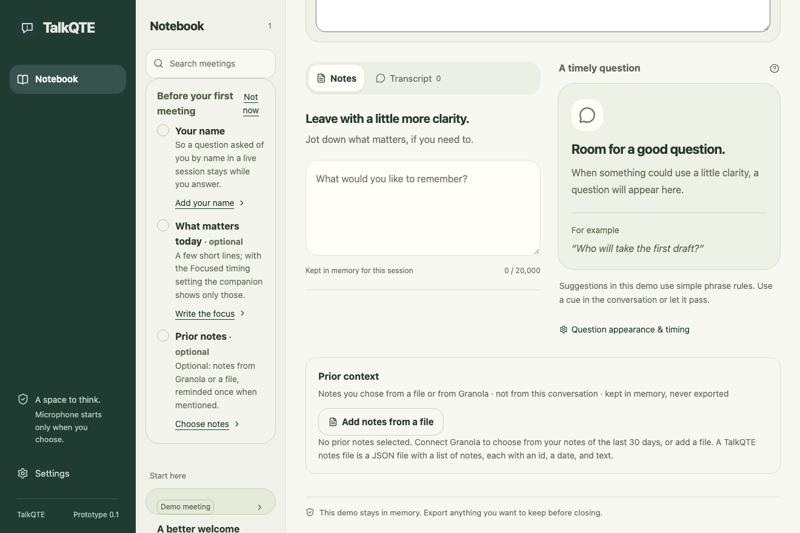
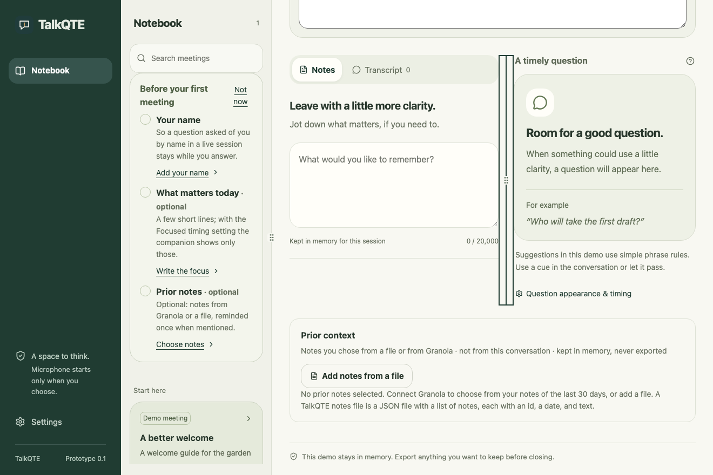

# Adjustable notebook panels

11 November 2026. Drag the divider beside the notebook list to change its width, or the divider between Notes/Transcript and the question to share the available space. The navigation rail remains fixed. This is column resizing; panels are not reordered or detached.

The user task is to make context readable without squeezing the current question out of view. The existing paper and evergreen appearance, optional setup and cue controls remain. The notebook column has a bounded width and scrolls when its contents are taller than the window. Notes and the question each retain a minimum width; they stack when their container cannot fit both. Smaller windows use the existing full-width notebook layout.

Focus a divider and use Left/Right to resize, Shift for larger steps, and Home/End for the limits. Escape cancels an active drag. **Panel sizes** in the toolbar offers clickable range controls and **Reset panel sizes**, so dragging is optional. Escape closes that menu and returns focus to its summary. Widths survive Settings navigation and window resizing for the current app session; they reset on reload or quit. No meeting data, capture command, provider request or persistence is added.

The separator labels, controlled-pane references and value properties are informed by the [W3C window splitter pattern](https://www.w3.org/WAI/ARIA/apg/patterns/windowsplitter/) (checked 11 November 2026). That page notes its pattern review is incomplete. This implementation preserves non-collapsible panels and does not claim full pattern conformance or native assistive-technology acceptance.

## UI/UX checkpoint

| Before: fixed widths | After: adjusted notebook and notes widths |
| --- | --- |
|  |  |

These browser captures use the bundled fictional demo at 1320 × 880 with reduced motion. The [600-pixel stacked view](assets/panels-narrow.png) keeps the question above the editor. The toolbar menu, focused dividers and scrollable notebook were also visually inspected. No owner's screenshot or account content is included.

Seven scenarios pass in Chromium and WebKit (14 checks): dragging both boundaries, readable limits, keyboard values, Escape and pointer cancellation, clickable sliders/reset, session-only sizing, and responsive restoration without losing typed notes. Fifty-four surrounding notebook and Granola checks also pass across both browsers. Frontend build and formatting pass. Browser checks use fictional preview/IPC state and do not establish native webview dragging, VoiceOver, or improved listening and participation.

Acceptance: the bounded browser interaction is ready. Next native check: resize both dividers in the desktop app, navigate the controls with keyboard/VoiceOver, and confirm the question and existing capture controls remain reachable. Whether adjustable widths reduce effort during a conversation remains a user-validation question.
