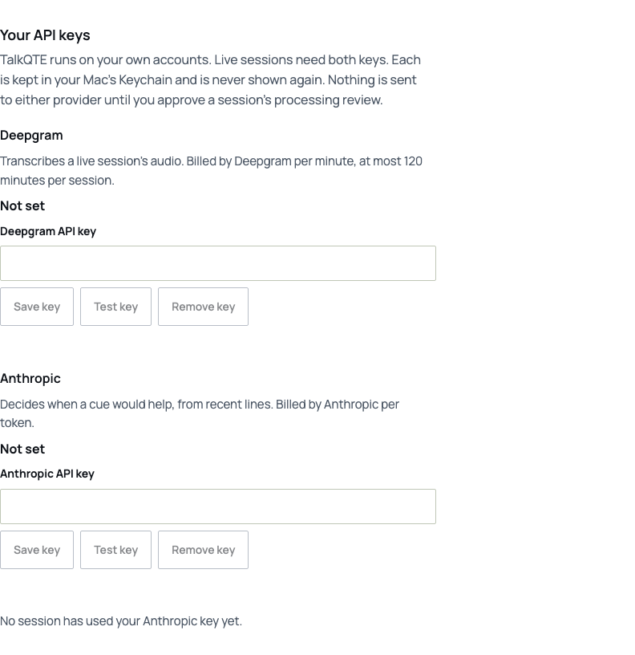

# Provider keys

TalkQTE runs on the person's own provider accounts: a transcription key (your
**Deepgram** API key, the default, or your **ElevenLabs** API key) and an API
key for the chosen cue provider (`Anthropic`, `OpenAI`, or `Gemini`). This page
describes how the keys are stored and the commands the notebook uses. Live
sessions use the chosen transcription provider's key for
[transcription](cloud-transcription.md) and the selected cue provider's key for
[cue decisions](own-key-cues.md). After a session, that same selected provider's
key can also write [meeting notes](meeting-notes.md), one confirmed request per
meeting.

## In Settings

**Settings → Your API keys** (`src/components/ProviderKeys.tsx`) has one form
per provider (`deepgram`, `elevenlabs`, `anthropic`, `openai`, `gemini`): what
the key is for and how it is billed, its state (**Not set**, **Set, not checked
yet**, **Set and checked**, **Rejected by … Replace it with a new key.**, or
**Could not be read from the Keychain**), a password field that is cleared after
saving or after a refused save, and **Save key**, **Test key** and **Remove key**.
Errors are the fixed messages below, announced as alerts. Below the key forms,
the current session's cue requests and estimated spend are shown as `"This
session: 12 of 400 cue requests, about $0.03 of $0.50 (an estimate, not your
bill), model claude-haiku-5-5."` for built-in models, or `"This session: 7 of
400 cue requests. Estimated spend unavailable for custom model …."` when a custom
model ID is used, read when Settings opens. Below the usage line, Settings also
holds **Transcription provider** (**Deepgram**, default, or **ElevenLabs**),
**Cue & notes provider** (`Anthropic`, `OpenAI`, or `Gemini`), **Cue model** +
**Custom cue model ID (optional)**, **Transcription language**, and **Model for
meeting notes** + **Custom meeting notes model ID (optional)**. The browser
preview keeps fictional keys in memory and cannot check one.



## Storage

- Keys are kept only in the system's secret store, under the service
  `app.talkqte.provider-key` with the accounts `deepgram`, `elevenlabs`,
  `anthropic`, `openai`, and `gemini` (`src-tauri/src/provider_keys.rs`). TalkQTE
  writes no key to a file.
  - **macOS:** the login Keychain, as generic passwords. The Keychain encrypts
    them.
  - **Windows:** Credential Manager, as generic credentials named
    `app.talkqte.provider-key/deepgram`, `app.talkqte.provider-key/elevenlabs`,
    `app.talkqte.provider-key/anthropic`, `app.talkqte.provider-key/openai`, and
    `app.talkqte.provider-key/gemini`,
    persisted for this user on this computer (not the roaming "enterprise"
    persistence). Windows protects them with the user's logon credentials
    (DPAPI). They are visible and removable in **Control Panel → Credential
    Manager → Windows Credentials** (`provider_keys/windows.rs`).
  - **Linux:** the desktop keyring through the freedesktop Secret Service on
    the session D-Bus (GNOME Keyring on Ubuntu, or KWallet and others that
    implement it), one item per key in the default collection with the
    attributes `service` and `account`, labelled "TalkQTE provider key (…)".
    The keyring encrypts what it stores. The key crosses the local session bus
    in the Secret Service's plain transfer to that keyring
    (`provider_keys/secret_service.rs`).
  - **No store:** Linux without a session bus or a Secret Service provider
    (headless, minimal or some tiling-window-manager sessions). Keys cannot be
    saved: both read as `unreadable`, the status reports the store unavailable,
    saving is refused with "This system has no keyring TalkQTE can use, so keys
    cannot be saved here yet. Nothing was changed." and Settings says so. They
    are never kept anywhere else instead.
- A key crosses from the notebook to Rust once, when it is entered. It is never
  sent back to the webview, never logged and never put in an error message;
  its in-memory copy is wiped once used, and its `Debug` form is redacted.
- A key's shape is checked before it is stored. Anthropic: a Console API key
  starting `sk-ant-api` or `sk-ant-usr-` (admin keys and other `sk-ant-`
  credentials are refused), 40 to 256 characters of letters, digits, `-` and
  `_`. OpenAI: a standard API key starting `sk-` (excluding `sk-ant-`), 20 to
  256 characters of letters, digits, `-` and `_`. Gemini: a Google AI Studio key
  starting `AIza`, 30 to 128 characters of letters, digits, `-` and `_`.
  Deepgram: 32 to 128 letters and digits. ElevenLabs: a key starting with `sk_`
  followed by letters, digits, `-` and `_` (32 to 256 characters total), or a
  32-to-64-character hexadecimal key. Whitespace around a pasted key is removed;
  anything else is refused without quoting what was pasted.
- Whether a key was checked or rejected is kept in memory for the app run.
- Checking whether a key is set does not unlock the Linux keyring: it searches
  the items' attributes only. Reading a key for a session or a check may show
  the keyring's own unlock prompt.
- macOS may ask the person to allow TalkQTE to use a key it stored, for
  example after a development rebuild changes the app's signature. This has
  not been checked on a signed build.

## Commands

These commands are main-window commands (`provider_keys_*` return the same
status payload). The first-run screen reads `provider_keys_status` at launch.

| Command                      | Arguments           | What it does                                                                                                                                                                                                                                                                                                                                                                                                                                                                                                                                                                                                                                                                                            |
| ---------------------------- | ------------------- | ------------------------------------------------------------------------------------------------------------------------------------------------------------------------------------------------------------------------------------------------------------------------------------------------------------------------------------------------------------------------------------------------------------------------------------------------------------------------------------------------------------------------------------------------------------------------------------------------------------------------------------------------------------------------------------------------------- |
| `provider_keys_status`       | none                | Reads which keys are stored. Sends nothing.                                                                                                                                                                                                                                                                                                                                                                                                                                                                                                                                                                                                                                                             |
| `set_provider_key`           | `{ provider, key }` | Checks the shape, then stores or replaces the key. Sends nothing to the provider.                                                                                                                                                                                                                                                                                                                                                                                                                                                                                                                                                                                                                       |
| `test_provider_key`          | `{ provider }`      | One read-only request with the stored key: `GET https://api.deepgram.com/v1/projects` (`Authorization: Token …`), `GET https://api.elevenlabs.io/v1/user` (`xi-api-key: …`), `GET https://api.anthropic.com/v1/models?limit=1` (`x-api-key`, `anthropic-version: 2026-10-21`), `GET https://api.openai.com/v1/models` (`Authorization: Bearer …`), or `GET https://generativelanguage.googleapis.com/v1beta/models?pageSize=1` (`x-goog-api-key` header only, never in the URL query string). None is billed. HTTP 200 marks the key checked; 401 or 403 (or 400 `API_KEY_INVALID` on Gemini) marks it rejected; anything else is reported as unreachable and changes nothing. The response body is never read (except the bounded Gemini 400 error reason check). |
| `remove_provider_key`        | `{ provider }`      | Deletes the key from the Keychain.                                                                                                                                                                                                                                                                                                                                                                                                                                                                                                                                                                                                                                                                      |
| `transcription_provider`     | none                | Returns the saved transcription provider (`"deepgram"` or `"elevenlabs"`).                                                                                                                                                                                                                                                                                                                                                                                                                                                                                                                                                                                                                              |
| `set_transcription_provider` | `{ provider }`      | Saves the transcription provider in `settings.json` when no live session is starting, running, or finishing.                                                                                                                                                                                                                                                                                                                                                                                                                                                                                                                                                                                             |
| `provider_preferences`       | none                | Reads active cue & notes provider and model selections/overrides. Sends nothing.                                                                                                                                                                                                                                                                                                                                                                                                                                                                                                                                                                                                                        |
| `set_cue_provider`           | `{ provider }`      | Selects `"anthropic"`, `"openai"`, or `"gemini"` between live sessions and clears provider-specific custom model overrides.                                                                                                                                                                                                                                                                                                                                                                                                                                                                                                                                                                             |
| `set_cue_model_override`     | `{ model }`         | Sets or clears an optional cue model ID (`[A-Za-z0-9._:/-]+`, max 96 chars, no `..`) between live sessions.                                                                                                                                                                                                                                                                                                                                                                                                                                                                                                                                                                                             |
| `set_notes_model_override`   | `{ model }`         | Sets or clears an optional meeting notes model ID (`[A-Za-z0-9._:/-]+`, max 96 chars, no `..`).                                                                                                                                                                                                                                                                                                                                                                                                                                                                                                                                                                                                         |

`provider` for key commands is `"deepgram"`, `"elevenlabs"`, `"anthropic"`, `"openai"`, or `"gemini"`. The payload:

```json
{
  "deepgram": { "state": "notSet", "verified": false },
  "elevenlabs": { "state": "notSet", "verified": false },
  "anthropic": { "state": "set", "verified": true },
  "openai": { "state": "notSet", "verified": false },
  "gemini": { "state": "notSet", "verified": false },
  "anyMissing": true,
  "store": { "kind": "keychain", "available": true }
}
```

`store.kind` is `keychain`, `credentialManager` or `secretService` (`memory`
only in tests); `store.available` is false only where that store does not
exist on the system. `state` is `notSet`, `set`, `rejected` or `unreadable`
(the store could not be read, so whether a key is stored is unknown; nothing is attempted with
it, and it does not count as missing). Each status call reads the Keychain
again, so a key deleted or added outside TalkQTE is seen. `verified` is true only after a
passing check in this app run, and is cleared when the key is replaced or
rejected. `anyMissing` is true while neither `deepgram` nor `elevenlabs` is
set, or none of `anthropic`, `openai`, or `gemini` is set: the "no keys set"
state a first-run screen asks for. A failed command returns one fixed message,
for example "That does not look like an Anthropic API key. It starts with
sk-ant-api." or "Deepgram could not be reached to check the key. Nothing was
changed." After every change the main window also receives
`provider-keys:changed` with the same payload.

`cue_usage` (no arguments) returns the current session's
`{ provider, model, requests, requestCap, spentMicroUsd, spendCapMicroUsd, customModel }`
for the active cue connection (`spentMicroUsd` and `spendCapMicroUsd` are `null`
when `customModel` is `true`), or `null` before a session has used it.

## Evidence

Offline Rust tests in `provider_keys` use an in-memory store and a scripted
check. They cover a new install reporting no keys, storing without contacting
the provider, shape refusals, a check sending the key only to its own
provider, rejected and unreachable results, removal, a key found at launch, a
store failure, a system with no store, and redacted debug output. On CI, a
fictional key under the test-only service `app.talkqte.provider-key.ci-test`
is written, read, replaced and removed in the runner's real Credential Manager
(Windows x64) and in a throwaway GNOME Keyring in its own session bus
(Ubuntu x64 and ARM64), and a session bus with no Secret Service is reported
unavailable. The test build cannot reach the
real Keychain or network. Not yet checked: the real Keychain on a signed
build, Credential Manager and GNOME Keyring in a person's desktop session
(including the keyring's unlock prompt), KWallet, and either provider's real
response to the check.
